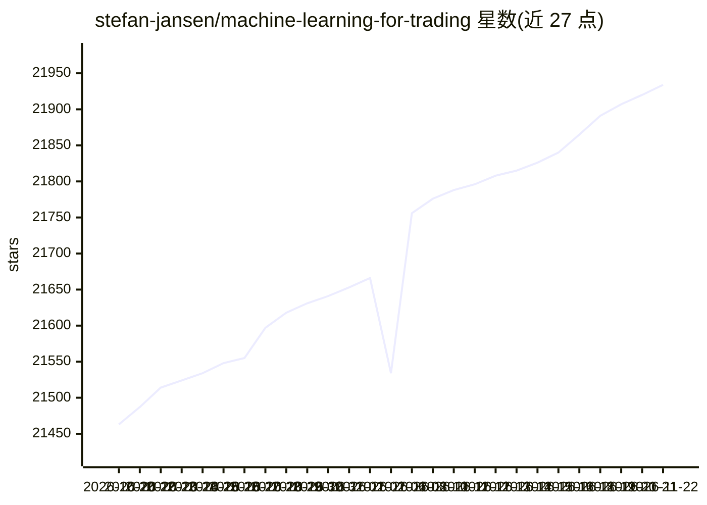

# stefan-jansen/machine-learning-for-trading

⭐ 21,934 · Jupyter Notebook · MIT · 推送 2026-11-21 · [GitHub](https://github.com/stefan-jansen/machine-learning-for-trading) · [官网](https://ml4trading.io) · 个人维护

**《Machine Learning for Trading》第3版全书代码，覆盖交易 ML 全流程**

Stefan Jansen 所著《Machine Learning for Trading》第3版的配套代码仓库，含 27 章、六个工作流对齐部分与九个贯穿全书的案例研究（ETF、加密永续、日内股票、期权、外汇、期货等）。内容从金融数据基础设施、特征工程、模型开发到回测、组合构建与实盘部署，数据层使用 Polars，每章提供可复现 Docker 环境。第二版移至 second-edition 分支维护。

## 筛选速览

| 维度 | 判定 | 备注 |
|---|---|---|
| AI 角色 | `ai-knowledge` | 知识聚合/清单类 |
| 许可风险 | `permissive` | MIT |
| 部署形态 | `self-host` | docker 或自建部署 |
| 模型依赖 | — | README 未给出锁定关系 |
| 硬件要求 | — | 无带数字的原话,不猜 |
| 安装摩擦 | `low` | 无编译、无系统依赖或容器化 |
| 成熟度 | — | 结构信号不足 |

## 动量与使用信号

- 维护:`active` — 距上次 push 2.2 天,年发版 5,17 位贡献者
- 涨星:近 1 天 **+28**(自 20261016 起算)

## 能力要点

- 27 章代码与九个全流程案例研究
- 每章提供可复现 Docker 环境，数据层采用 Polars
- 覆盖生成式 AI（SEC 文件 RAG、Graph RAG、多智能体）与因果 ML、强化学习章节
- 附 Maven 平台课程与免费直播课日程

## 适用场景

- 按书学习从数据获取到实盘执行的 ML 交易工作流
- 复现 ETF、期权、外汇等市场的量化策略案例
- 查阅时间序列深度模型与因果推断在金融中的应用实现

## 场景标签

`金融量化` `教程课程` `强化学习` `RAG` · 领域:知识与检索

## 证据(README 行号)

> L1: # Machine Learning for Trading, 3rd Edition
> L5: The code for *Machine Learning for Trading, 3rd Edition* by
> L6: Stefan Jansen: 27 chapters and nine case studies, rebuilt

## 星数曲线

2026-10-20 21,463 → 2026-11-22 21,934（+471）

---
*卡片 v1 · prompt 1.4 · 生成 2026-11-22 · 置信度 high · 依据 README sha `ddd2e91fab83` · [字段定义](../../DATASET.md)*
