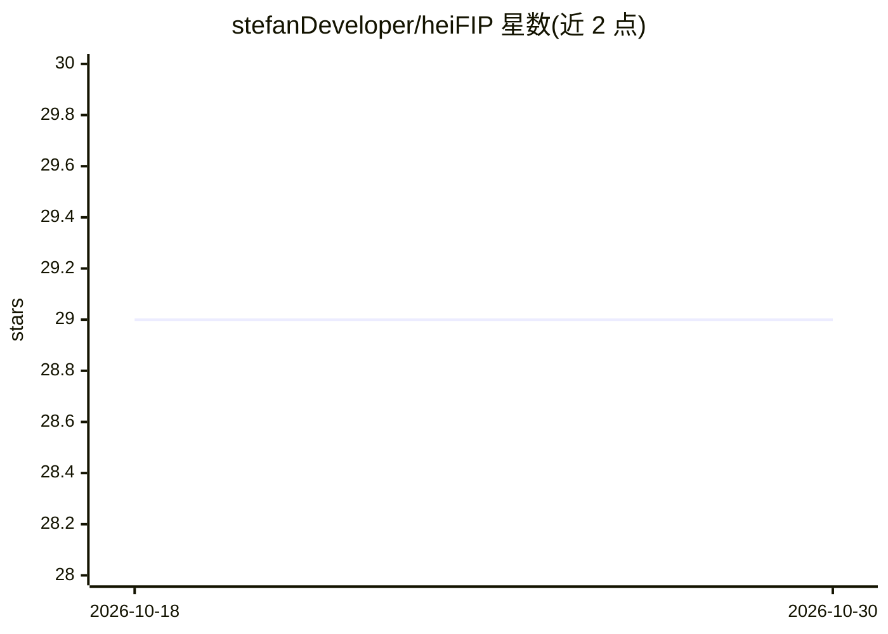

# stefanDeveloper/heiFIP

⭐ 29 · C++ · EUPL-1.2 · 推送 2026-03-27 · [GitHub](https://github.com/stefanDeveloper/heiFIP) · 组织维护

**将网络流量 pcap 转为图像的深度学习数据预处理工具**

Heidelberg Flow Image Processor（heiFIP）以 C++ 实现，读取离线 pcap 抓包文件，将单个数据包或网络流转换为字节图像或马尔可夫转移矩阵图像，用于恶意软件流量分类等深度学习场景，目标是使网络流量图像表示可复现。支持多种图像模式（PacketImage/FlowImage/Tiled/Markov）、头部字段定制、去除负载与去重，通过 CLI 从 pcap 生成图像。仅支持离线分析，计划支持在线模式；需 C++ 编译器、CMake 与 vcpkg 从源码构建。

## 筛选速览

| 维度 | 判定 | 备注 |
|---|---|---|
| AI 角色 | `ai-ecosystem` | LLM/agent 周边工具 |
| 许可风险 | `viral` | EUPL-1.2 |
| 部署形态 | `None` |  |
| 模型依赖 | — | README 未给出锁定关系 |
| 硬件要求 | — | 无带数字的原话,不猜 |
| 安装摩擦 | `medium` | 含编译或系统依赖之一 |
| 成熟度 | `idea` | |

## 能力要点

- 将 pcap 数据包/流转换为字节图像与马尔可夫转移矩阵图像（6 种图像模式）
- 头部字段定制与去除负载选项，用于消除偏置字段
- 流级去重、最小/最大包数与图像维度控制
- CLI 从 pcap 文件批量生成图像，支持多线程

## 适用场景

- 为恶意软件流量分类的深度学习模型生成可复现的图像训练数据
- 复现论文中网络流量图像表示的实验结果
- 将抓包数据批量转为图像用于 ML/DL 实验

## 场景标签

`网络安全` · 领域:学习与行业

## 证据(README 行号)

> L4: It is a tool designed to extract essential parts of packets and convert them into images for deep learning purposes.
> L38: The idea to create heiFIP came from working with Deep Learning approaches to classify malware traffic on images. Ma

## 星数曲线

2026-10-18 29 → 2026-10-30 29（+0）

---
*卡片 v1 · prompt 1.4 · 生成 2026-10-26 · 置信度 high · 依据 README sha `e1d58eb3d13b` · [字段定义](../../DATASET.md)*
