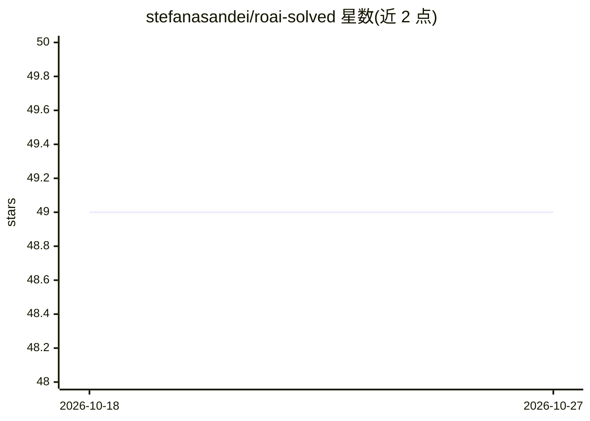

# stefanasandei/roai-solved

⭐ 49 · Jupyter Notebook · MIT · 推送 2026-07-04 · [GitHub](https://github.com/stefanasandei/roai-solved) · 个人维护

**AI 奥林匹克竞赛题解集：IOAI 类赛事任务解法汇编**

个人维护的竞赛题解仓库：收录 IOAI、IAIO、NEOAI、APOAI、波兰/罗马尼亚/格鲁吉亚 AI 奥林匹克及 Nitro Judge、ML Compete 平台（2023-2026）任务的参考解法，均取得该题允许的最高分。按 contests/national-contests/international-contests 目录组织，另提供核心解题思路速查文件。README 说明了 IOAI 与 CEOAI 的赛制差异（6 小时限时、禁用互联网与 LLM）。仓库持续更新中，MIT 许可。

## 筛选速览

| 维度 | 判定 | 备注 |
|---|---|---|
| AI 角色 | `ai-knowledge` | 知识聚合/清单类 |
| 许可风险 | `permissive` | MIT |
| 部署形态 | `None` |  |
| 模型依赖 | — | README 未给出锁定关系 |
| 硬件要求 | — | 无带数字的原话,不猜 |
| 安装摩擦 | `low` | 无编译、无系统依赖或容器化 |
| 成熟度 | — | 结构信号不足 |

## 能力要点

- 覆盖 IOAI/IAIO/NEOAI/APOAI 及多国国家级 AI 奥林匹克的题解
- 所有已发布解法取得该题允许的最高分
- 附各任务核心思路的速查（reference solutions）文件

## 适用场景

- 备考 IOAI 类竞赛时查阅已解任务的思路与实现
- 了解各国 AI 奥林匹克的题型与评分方式
- 按目录定位特定赛事（国家级/国际级）的解法

## 场景标签

`教程课程` · 领域:学习与行业

## 证据(README 行号)

> L3: Here you can find my solutions for tasks from various IOAI-like contests (including many tasks from the Nitro AI Jud
> L28: A complete catalog of solved tasks can also be found in reference solutions.

## 星数曲线

2026-10-18 49 → 2026-10-27 49（+0）

---
*卡片 v1 · prompt 1.4 · 生成 2026-10-24 · 置信度 high · 依据 README sha `983de1cb0b4c` · [字段定义](../../DATASET.md)*
