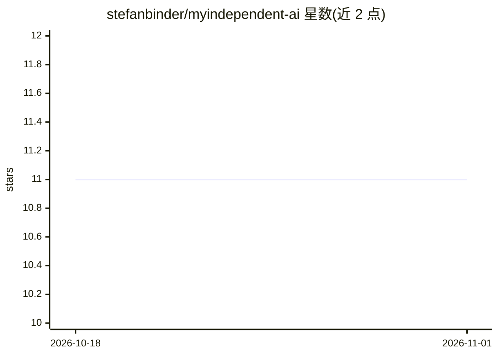

# stefanbinder/myindependent-ai

⭐ 11 · Python · MIT · 推送 2026-03-11 · [GitHub](https://github.com/stefanbinder/myindependent-ai) · [官网](https://myindependent.ai/) · 个人维护

**全本地隐私优先的个人 AI 助手：用自己的数据做问答**

自托管的个人 AI 助手，将邮件、文档、聊天等个人数据导入本地 Qdrant 向量库，通过 Ollama 提供的本地 LLM（llama3.2）与嵌入模型（nomic-embed-text）进行 RAG 问答，数据不离开本机。以 Docker Compose 一键启动，Streamlit 提供 Web 聊天界面；附 Gmail 等导入器（Gmail 需 OAuth 凭据），另支持不依赖 Docker 的本地开发方式与 GCP 部署的 infrastructure 目录。

## 筛选速览

| 维度 | 判定 | 备注 |
|---|---|---|
| AI 角色 | `ai-native` | 本体是模型或模型工具 |
| 许可风险 | `permissive` | MIT |
| 部署形态 | `self-host` | docker 或自建部署 |
| 模型依赖 | local-ok | 支持本地模型 |
| 硬件要求 | — | 无带数字的原话,不猜 |
| 安装摩擦 | `low` | 无编译、无系统依赖或容器化 |
| 成熟度 | — | 结构信号不足 |

## 能力要点

- Docker Compose 一键启动，首次运行自动拉取 llama3.2 与 nomic-embed-text
- Gmail 等导入器将个人数据写入本地 Qdrant 向量库
- Streamlit 聊天界面，Ollama 提供本地 LLM 与嵌入

## 适用场景

- 在本机对邮件和文档做私有问答，数据不上传
- 自托管一个个人知识库 RAG 助手

## 场景标签

`AI 助手` `RAG` `文档问答` · 领域:对话与助手

## 证据(README 行号)

> L3: A fully local, privacy-first personal AI assistant. Ask questions about your own data — emails, documents, chats — w
> L26: |Ollama|http://localhost:11434|Local LLM + embeddings|

## 星数曲线

2026-10-18 11 → 2026-11-01 11（+0）

---
*卡片 v1 · prompt 1.4 · 生成 2026-11-01 · 置信度 high · 依据 README sha `a444ef398c3a` · [字段定义](../../DATASET.md)*
