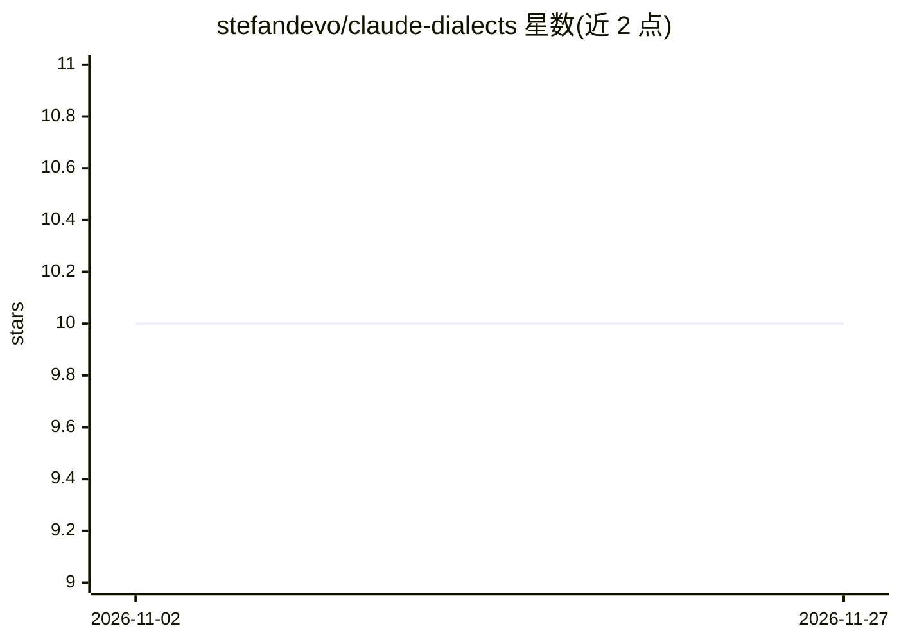

# stefandevo/claude-dialects

⭐ 10 · Go · MIT · 推送 2026-11-24 · [GitHub](https://github.com/stefandevo/claude-dialects) · [官网](https://claude-dialects.cc) · 个人维护

**为开发者隔离运行多模型版 Claude Code 的 CLI 工具**

一个 Go 编写的 CLI 工具（cc-dialect），为每个方言（dialect）生成独立配置的 Claude Code 命令：各自持有模型路由、环境变量、Claude Code 配置、历史、代理密钥、端口与运行时状态，内嵌 CLIProxyAPI 代理实例而无需手动搭建代理。提供 11 条 provider 路由预设（Codex、GLM、Kimi、Gemini、Grok、MiniMax、DeepSeek、Cursor、GitHub Copilot、Claude、混合），支持 OAuth 或 API key 认证，附 doctor 诊断与 upgrade 自更新机制。依赖本机已安装的 claude CLI 与 Go 工具链构建，macOS/Linux amd64/arm64。

## 筛选速览

| 维度 | 判定 | 备注 |
|---|---|---|
| AI 角色 | `ai-ecosystem` | LLM/agent 周边工具 |
| 许可风险 | `permissive` | MIT |
| 部署形态 | `None` |  |
| 模型依赖 | locked-api |  |
| 硬件要求 | — | 无带数字的原话,不猜 |
| 安装摩擦 | `medium` | 含编译或系统依赖之一 |
| 成熟度 | — | 结构信号不足 |

## 能力要点

- 每个方言隔离的配置、历史、代理密钥与端口，内嵌 CLIProxyAPI
- 11 条 provider 路由预设，OAuth 与 API key 双认证路径
- doctor 诊断命令区分上游故障与冷却重试
- cc-dialect upgrade 原子替换二进制自更新

## 适用场景

- 在同一台机器上为不同模型各自维护一套独立的 Claude Code 环境
- 用 Z.ai/Kimi/DeepSeek 等 key 驱动 Claude Code 界面
- 排查方言认证与上游 503 类故障

## 场景标签

`模型网关` `编码 Agent` · 领域:Agent 开发

## 证据(README 行号)

> L7: Create multiple native-feeling Claude Code commands powered by different models.
> L11: CLIProxyAPI instance. Embedded
> L130: |Provider route|Presets|Authentication|Recommended command|

## 星数曲线

2026-11-02 10 → 2026-11-27 10（+0）

---
*卡片 v1 · prompt 1.4 · 生成 2026-11-19 · 置信度 high · 依据 README sha `1c92f90dfd42` · [字段定义](../../DATASET.md)*
