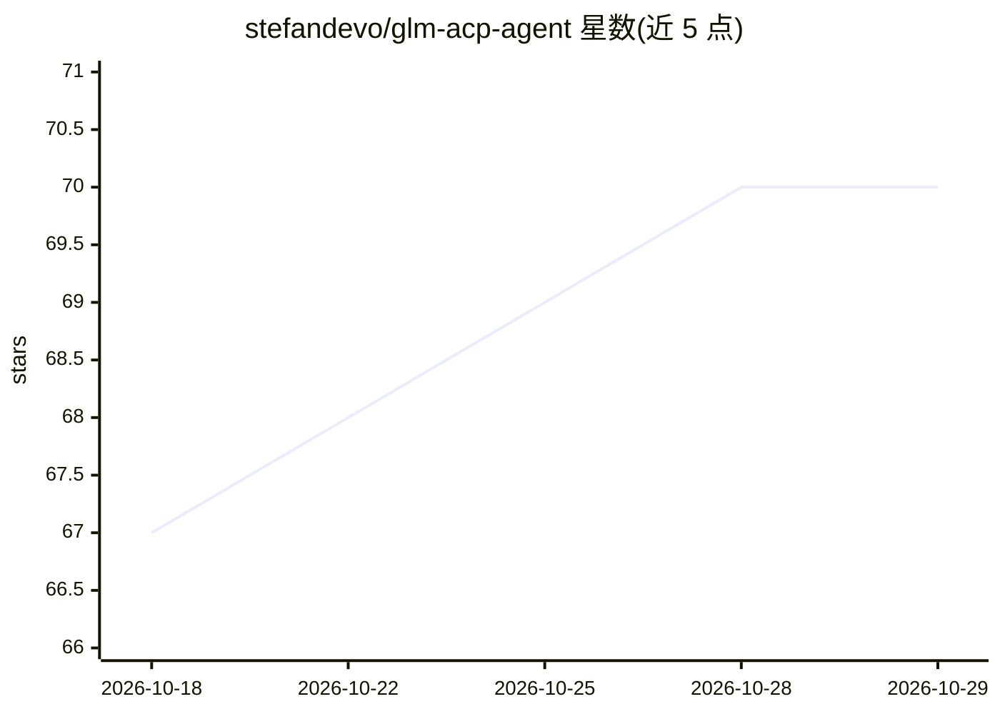

# stefandevo/glm-acp-agent

⭐ 70 · TypeScript · Apache-2.0 · 推送 2026-10-27 · [GitHub](https://github.com/stefandevo/glm-acp-agent) · [官网](https://www.npmjs.com/package/glm-acp-agent) · 个人维护 · 中文 README

**接入智谱 GLM 编程套餐模型的 ACP 编程 agent（TypeScript）**

以 TypeScript 实现的 Agent Client Protocol（ACP）agent，通过 stdio 连接任意 ACP 兼容 IDE/客户端，以 Z.AI/智谱 GLM 系列模型（GLM-5.3、GLM-5.3 Flash、GLM-5 Turbo、GLM-4.7）为推理核心。面向 Z.AI GLM Coding Plan 构建，默认调用 Coding Plan 端点，同一 API key 用于模型调用与配套工具；非 Coding Plan 的通用开放平台 API 计费不在范围内。实现 ACP 会话管理、流式输出、工具调用（默认最多 100 轮）、思维链转发、会话持久化与权限模式；文件/Shell 工具运行于 agent 进程 OS 用户权限下，不提供沙箱隔离。

## 筛选速览

| 维度 | 判定 | 备注 |
|---|---|---|
| AI 角色 | `ai-native` | 本体是模型或模型工具 |
| 许可风险 | `permissive` | Apache-2.0 |
| 部署形态 | `library` | 以包/库形式分发 |
| 模型依赖 | — | README 未给出锁定关系 |
| 硬件要求 | — | 无带数字的原话,不猜 |
| 安装摩擦 | `low` | 无编译、无系统依赖或容器化 |
| 成熟度 | — | 结构信号不足 |

## 能力要点

- 实现完整 ACP 会话生命周期（new/load/fork/resume/set_model 等）与流式输出
- 九个内置工具：文件、Shell、Web 搜索/读取、图像分析等，权限按会话模式控制
- 同一 Coding Plan API key 驱动 GLM 模型调用与 Coding Plan 工具
- 启发式上下文压缩：超预算时移除较早对话并缩短工具结果

## 适用场景

- 在 ACP 兼容 IDE 中通过 GLM 编程套餐模型获得编程助手
- 让 agent 读写工作区文件、执行命令与联网查询
- 跨会话保存、分支与恢复编程对话

## 场景标签

`编码 Agent` · 领域:编码与开发

## 证据(README 行号)

> L3: An Agent Client Protocol (ACP) agent written in TypeScript that uses the **Z.AI / Zhipu AI GLM** model family (GLM-5
> L5: The agent connects to any ACP-compatible IDE or client over **stdio**, streams responses back in real time, and can 
> L13: `glm-acp-agent` is intentionally built for the **Z.AI GLM Coding Plan**. It is not a general-purpose Z.AI Open Plat

## 星数曲线

2026-10-18 67 → 2026-10-29 70（+3）

---
*卡片 v1 · prompt 1.4 · 生成 2026-10-24 · 置信度 high · 依据 README sha `72863e900e2e` · [字段定义](../../DATASET.md)*
