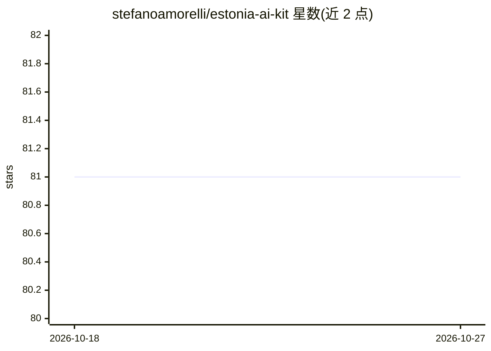

# stefanoamorelli/estonia-ai-kit

⭐ 81 · TypeScript · AGPL-3.0 · 推送 2026-06-30 · [GitHub](https://github.com/stefanoamorelli/estonia-ai-kit) · [官网](https://github.com/stefanoamorelli/estonia-ai-kit) · 个人维护

**连接 AI 应用与爱沙尼亚政务/银行服务的 MCP 与 CLI 工具集**

社区驱动的开源工具集，通过 MCP servers、Go CLI 和 AI 编码 agent 技能，把 Claude、GPT 等 AI 应用接入爱沙尼亚政府与私营服务：商业注册（RIK）、统计开放数据、税务申报（EMTA）、LHV 银行账户与支付、法律文档 RAG 等。需认证的 CLI 通过 Smart-ID 登录，会话约 30 分钟过期；多个组件标注为 WIP 状态。项目声明与爱沙尼亚政府无隶属关系。

## 筛选速览

| 维度 | 判定 | 备注 |
|---|---|---|
| AI 角色 | `ai-ecosystem` | LLM/agent 周边工具 |
| 许可风险 | `viral` | AGPL-3.0 |
| 部署形态 | `library` | 以包/库形式分发 |
| 模型依赖 | — | README 未给出锁定关系 |
| 硬件要求 | — | 无带数字的原话,不猜 |
| 安装摩擦 | `low` | 无编译、无系统依赖或容器化 |
| 成熟度 | `idea` | |

## 能力要点

- RIK 商业注册与开放数据 MCP server
- EMTA 税务与 LHV 银行 Go CLI，Smart-ID 认证
- Claude Code 插件市场，技能教 agent 使用对应 CLI
- 法律文档 RAG 管道（WIP）

## 适用场景

- 让 Claude 等 AI 助手查询爱沙尼亚商业注册与开放数据
- 在终端或通过 AI agent 查询自己的税务申报与 LHV 银行账户
- 为 AI 编码 agent 安装爱沙尼亚服务技能插件

## 场景标签

`AI 助手` · 领域:对话与助手

## 证据(README 行号)

> L35: Estonia AI Kit connects your AI applications directly to Estonian government services, open data, and digital infra
> L39: Model Context Protocol (MCP) is an open protocol that standardizes how AI applications connect with external data s

## 星数曲线

2026-10-18 81 → 2026-10-27 81（+0）

---
*卡片 v1 · prompt 1.4 · 生成 2026-10-24 · 置信度 mid · 依据 README sha `692afbd3e3cd` · [字段定义](../../DATASET.md)*
