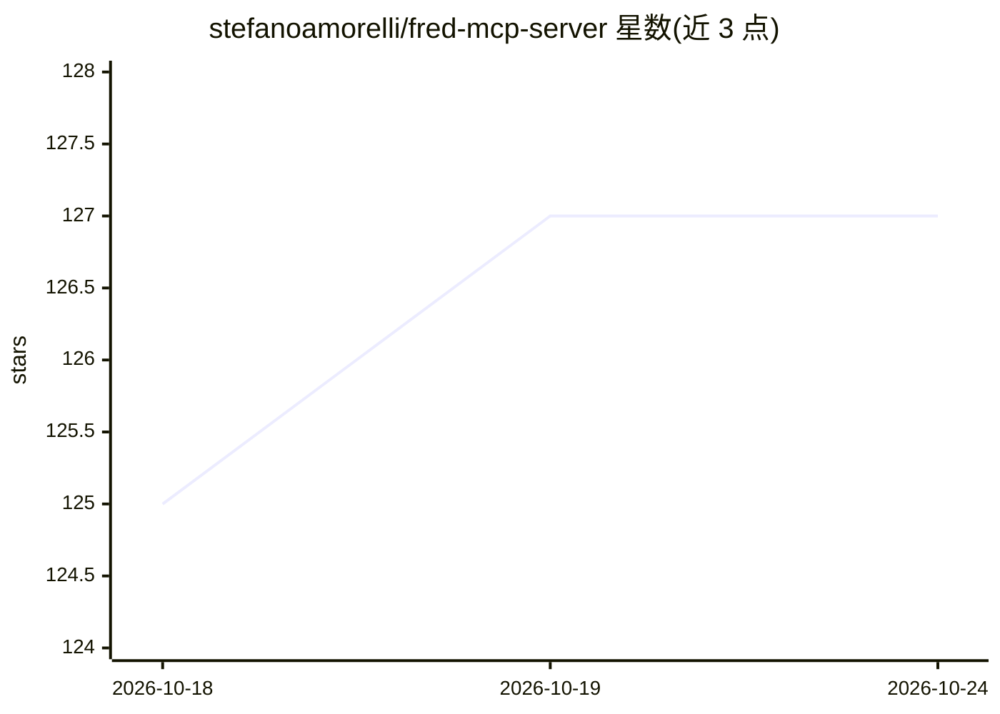

# stefanoamorelli/fred-mcp-server

⭐ 127 · TypeScript · AGPL-3.0 · 推送 2026-08-22 · [GitHub](https://github.com/stefanoamorelli/fred-mcp-server) · [官网](https://fred-mcp-server.amorelli.tech) · 个人维护

**为 LLM/agent 提供美联储经济数据（FRED）访问的 MCP 服务器**

基于 Model Context Protocol 的数据服务器，通过 fred_browse、fred_search、fred_get_series 三个工具向 MCP 客户端开放 FRED 全部 80 万+ 时间序列：浏览目录、按关键词/标签检索序列、按 ID 取数并支持 9 种数据变换与频率聚合。面向使用 Claude Desktop 等 MCP 客户端的开发者与金融分析用户，需自备 FRED API key。支持 stdio 与 Streamable HTTP 两种传输，内置令牌桶限流、LRU 缓存、并发请求合并与会话管理。以 AGPL-3.0 发布，提供 Docker 与源码安装方式。

## 筛选速览

| 维度 | 判定 | 备注 |
|---|---|---|
| AI 角色 | `ai-ecosystem` | LLM/agent 周边工具 |
| 许可风险 | `viral` | AGPL-3.0 |
| 部署形态 | `library` | 以包/库形式分发 |
| 模型依赖 | — | README 未给出锁定关系 |
| 硬件要求 | — | 无带数字的原话,不猜 |
| 安装摩擦 | `low` | 无编译、无系统依赖或容器化 |
| 成熟度 | — | 结构信号不足 |

## 能力要点

- 三个 MCP 工具覆盖 FRED 80 万+ 时间序列的浏览/检索/取数
- 取数支持 9 种数据变换（环比、同比、对数等）与频率聚合
- stdio 与 Streamable HTTP 双传输，含 /healthz 端点
- 客户端限流（令牌桶）、LRU 缓存与并发请求合并

## 适用场景

- 在 Claude Desktop 等 MCP 客户端中直接查询 GDP、失业率等经济指标
- 金融分析场景让 LLM 检索并变换 FRED 时间序列
- 网络部署时以 HTTP 传输向多会话提供经济数据访问

## 场景标签

`数据分析` `金融量化` · 领域:效率与自动化

## 证据(README 行号)

> L12: A Model Context Protocol (`MCP`) server providing universal access to all 800,000+ Federal Reserve Economic Data (F
> L125: This MCP server provides three comprehensive tools to access all 800,000+ FRED® economic data series:

## 星数曲线

2026-10-18 125 → 2026-10-24 127（+2）

---
*卡片 v1 · prompt 1.4 · 生成 2026-10-23 · 置信度 mid · 依据 README sha `c57c9e59afad` · [字段定义](../../DATASET.md)*
