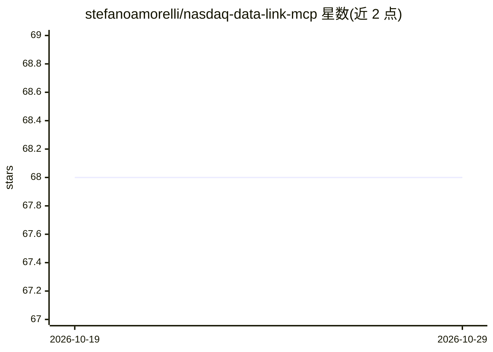

# stefanoamorelli/nasdaq-data-link-mcp

⭐ 68 · Python · MIT · 推送 2026-10-05 · [GitHub](https://github.com/stefanoamorelli/nasdaq-data-link-mcp) · [官网](https://amorelli.tech/open-source/nasdaq-data-link-mcp) · 个人维护

**让 LLM 通过 MCP 访问 Nasdaq 金融数据的服务器**

社区开发的 MCP（Model Context Protocol）服务器，把 Nasdaq Data Link 的金融与经济数据集接入 MCP 兼容客户端（如 Claude Desktop、Groq Desktop）。基于官方 Nasdaq/data-link-python SDK，暴露 5 个工具：按关键词搜索数据集、带日期过滤取数、读取元数据、列出数据库、导出 CSV/JSON/XML。需在 data.nasdaq.com 注册获取 API key，通过 uv + mcp CLI 安装注册。项目声明与 Nasdaq, Inc. 无隶属关系。

## 筛选速览

| 维度 | 判定 | 备注 |
|---|---|---|
| AI 角色 | `ai-ecosystem` | LLM/agent 周边工具 |
| 许可风险 | `permissive` | MIT |
| 部署形态 | `library` | 以包/库形式分发 |
| 模型依赖 | — | README 未给出锁定关系 |
| 硬件要求 | — | 无带数字的原话,不猜 |
| 安装摩擦 | `low` | 无编译、无系统依赖或容器化 |
| 成熟度 | — | 结构信号不足 |

## 能力要点

- 5 个工具：搜索/取数/元数据/列库/多格式导出
- 兼容任意 Nasdaq Data Link 数据库（100+ 个）
- 使用官方 data-link-python SDK
- 测试套件在无 API key 下可运行基础验证

## 适用场景

- 在 Claude Desktop 等客户端中用自然语言查询 GDP、股价等数据
- 为金融分析的 LLM 工作流接入 Nasdaq 数据源
- 把 Nasdaq 数据集导出为 CSV/JSON/XML 供后续使用

## 场景标签

`数据分析` `金融量化` · 领域:效率与自动化

## 证据(README 行号)

> L12: A community developed and maintained Model Context Protocol (MCP) server that provides access for large language mo
> L29: Once installed and connected to an `MCP`-compatible client (e.g., Claude Desktop, or Groq Desktop (beta), this serv

## 星数曲线

2026-10-19 68 → 2026-10-29 68（+0）

---
*卡片 v1 · prompt 1.4 · 生成 2026-10-24 · 置信度 mid · 依据 README sha `25d4b83d1ffc` · [字段定义](../../DATASET.md)*
