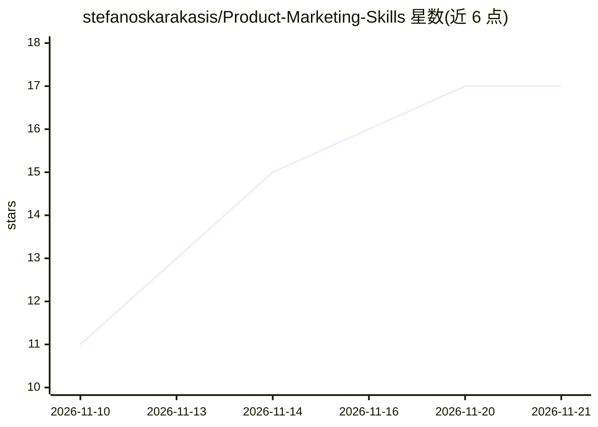

# stefanoskarakasis/Product-Marketing-Skills

⭐ 17 · Python · MIT · 推送 2026-11-20 · [GitHub](https://github.com/stefanoskarakasis/Product-Marketing-Skills) · [官网](https://stefanoskarakasis.substack.com/) · 个人维护

**面向产品营销人员的 50 个 AI agent 技能合集（Claude Code）**

面向 B2B SaaS 产品营销人员（PMM/GTM 负责人）的 50 个 AI agent 技能合集，覆盖定位、竞争情报、GTM 策略、增长实验、销售辅助与执行流程。核心机制是先用 product-marketing-context 生成 /foundation/brain.md 公司脑文档，其余技能读取后产出内容。技能为 SKILL.md 文件，通过 npx 安装、Claude Code 插件市场或复制文件夹方式部署；Slack/邮件等连接器按插件加载。

## 筛选速览

| 维度 | 判定 | 备注 |
|---|---|---|
| AI 角色 | `ai-knowledge` | 知识聚合/清单类 |
| 许可风险 | `permissive` | MIT |
| 部署形态 | `library` | 以包/库形式分发 |
| 模型依赖 | locked-api |  |
| 硬件要求 | — | 无带数字的原话,不猜 |
| 安装摩擦 | `low` | 无编译、无系统依赖或容器化 |
| 成熟度 | — | 结构信号不足 |

## 能力要点

- 50 个技能按 7 个插件组织（定位/竞争情报/销售/GTM/增长/执行/元技能）
- 以 /foundation/brain.md 公司脑为共享上下文，技能产出前统一读取
- 提供 Slack/邮件连接器与 .mcp.json 连接器目录
- 支持 Claude Code、Codex、Cursor 等读取 SKILL.md 的 agent

## 适用场景

- 从客户访谈构建 ICP 并撰写定位与信息层级
- 生成竞品档案、battlecard 和每周高管简报
- 规划发布层级与 GTM 策略、排序增长实验
- 准备 discovery call、处理买家异议与交易复盘

## 场景标签

`AI 写作` `提示工程` · 领域:Agent 开发

## 证据(README 行号)

> L5: A collection of AI agent skills focused on product marketing tasks.
> L9: Built for PMMs, product marketing leaders and GTM operators. Runs in Claude Code and Claude; the skills are plain `S
> L50: > Install `product-marketing-context` first, then add plugins as you need them. The full job-to-skill table is in d

## 星数曲线

2026-11-10 11 → 2026-11-21 17（+6）

---
*卡片 v1 · prompt 1.4 · 生成 2026-11-18 · 置信度 high · 依据 README sha `b1554d2f39f2` · [字段定义](../../DATASET.md)*
