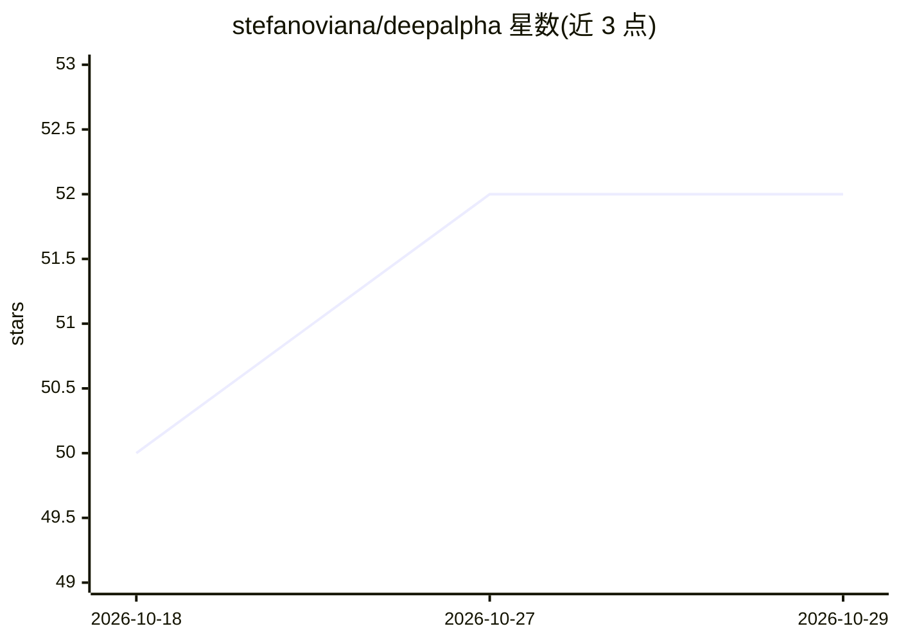

# stefanoviana/deepalpha

⭐ 52 · Python · MIT · 推送 2026-05-12 · [GitHub](https://github.com/stefanoviana/deepalpha) · [官网](https://deepalphabot.com) · 个人维护

**开源 ML 加密货币交易机器人：预测价格方向并自动交易**

Python 编写的加密货币量化交易系统，通过 ccxt 接入 Bybit、Binance、OKX 等 12 家交易所，使用 LightGBM/XGBoost 模型基于 72 个特征（L2 订单簿、资金费率、技术指标）预测价格方向，并配套 HMM 市场状态识别、清算水平分析、多级止盈、Pump 扫描器（监控 500+ 币对放量）与 Telegram 控制。自托管版仅含训练脚本、不含预训练模型，需 8GB+ RAM 自行训练；预训练模型与云端托管为付费方案（Pro $39/月、Lifetime $199）。

## 筛选速览

| 维度 | 判定 | 备注 |
|---|---|---|
| AI 角色 | `ai-native` | 本体是模型或模型工具 |
| 许可风险 | `permissive` | MIT |
| 部署形态 | `self-host` | docker 或自建部署 |
| 模型依赖 | — | README 未给出锁定关系 |
| 硬件要求 | — | 无带数字的原话,不猜 |
| 安装摩擦 | `low` | 无编译、无系统依赖或容器化 |
| 成熟度 | — | 结构信号不足 |

## 能力要点

- LightGBM/XGBoost 模型基于 72 个特征做方向预测，走前验证
- 支持 12 家交易所（经 ccxt 接入）
- Pump 扫描器实时监控 500+ 币对的放量与上新
- 自托管版含训练脚本但不含预训练模型，需自行训练

## 适用场景

- 自托管运行并自行训练 ML 交易模型进行自动交易
- 监控交易所放量行情并自动跟进交易
- 通过 Telegram 控制云端托管的交易机器人

## 场景标签

`金融量化` · 领域:学习与行业

## 证据(README 行号)

> L146: DeepAlpha is an open-source ML trading system that predicts crypto price direction on **18 exchanges** including B
> L203: DeepAlpha uses a LightGBM gradient boosting model trained on historical crypto data with walk-forward validation.
> L269: ### 1. AI Directional Prediction (Primary)

## 星数曲线

2026-10-18 50 → 2026-10-29 52（+2）

---
*卡片 v1 · prompt 1.4 · 生成 2026-10-24 · 置信度 high · 依据 README sha `8f6d7380a951` · [字段定义](../../DATASET.md)*
