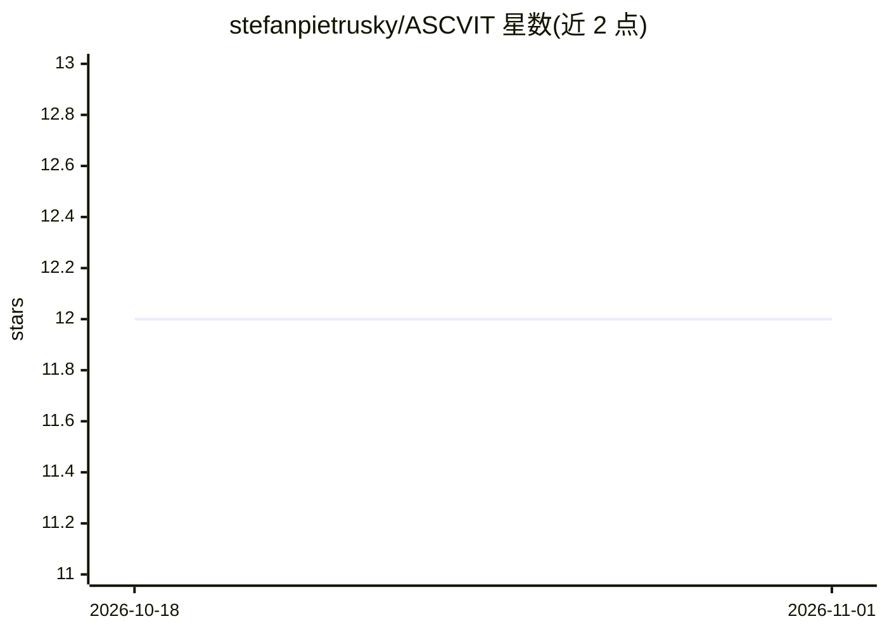

# stefanpietrusky/ASCVIT

⭐ 12 · Python · Apache-2.0 · 推送 2026-03-23 · [GitHub](https://github.com/stefanpietrusky/ASCVIT) · [官网](https://medium.com/data-science/ascvit-v1-automatic-statistical-calculation-visualization-and-interpretation-tool-aa910001a3a7) · 个人维护

**自动统计计算、可视化与 LLM 解读的本地数据分析工具**

面向数据评估与教育研究场景的本地 Flask 应用：读取 CSV 数据集，自动应用多种统计方法（t 检验/ANOVA/Chi²、Mann-Whitney U、Kruskal-Wallis 等），以 Plotly 生成交互式可视化，并通过 Ollama 本地安装的模型（如 Llama3.1 8B）对可视化结果做自动解读。V3 增加基于缺失率、方差、类别数等的数据概览推荐。作者声明该原型处于积极开发中、功能结构可能变动，用于社会工作和科研数据分析。

## 筛选速览

| 维度 | 判定 | 备注 |
|---|---|---|
| AI 角色 | `ai-enhanced` | 去掉 AI 部分产品仍成立 |
| 许可风险 | `permissive` | Apache-2.0 |
| 部署形态 | `library` | 以包/库形式分发 |
| 模型依赖 | local-ok | 支持本地模型 |
| 硬件要求 | — | 无带数字的原话,不猜 |
| 安装摩擦 | `low` | 无编译、无系统依赖或容器化 |
| 成熟度 | `idea` | |

## 能力要点

- 自动应用多种统计方法（含非参数检验与重复测量 ANOVA）
- Plotly 交互式可视化
- LLM 解读由 Ollama 本地模型按需选择
- 基于缺失率/方差/类别数的变量与流程推荐

## 适用场景

- 社会服务组织评估自有数据以理解财务需求
- 研究者对数据集自动执行统计检验并生成可视化
- 教育用途学习统计分析流程

## 场景标签

`数据分析` `科研工具` · 领域:效率与自动化

## 证据(README 行号)

> L4: This repository, developed by Stefan Pietrusky, is based on the article published at Towards Data Science [[1]](http
> L8: ASCVIT V3 expands the tool with greater statistical coverage, more automation, and additional guidance on what is po

## 星数曲线

2026-10-18 12 → 2026-11-01 12（+0）

---
*卡片 v1 · prompt 1.4 · 生成 2026-11-01 · 置信度 mid · 依据 README sha `6e44e324f5ae` · [字段定义](../../DATASET.md)*
