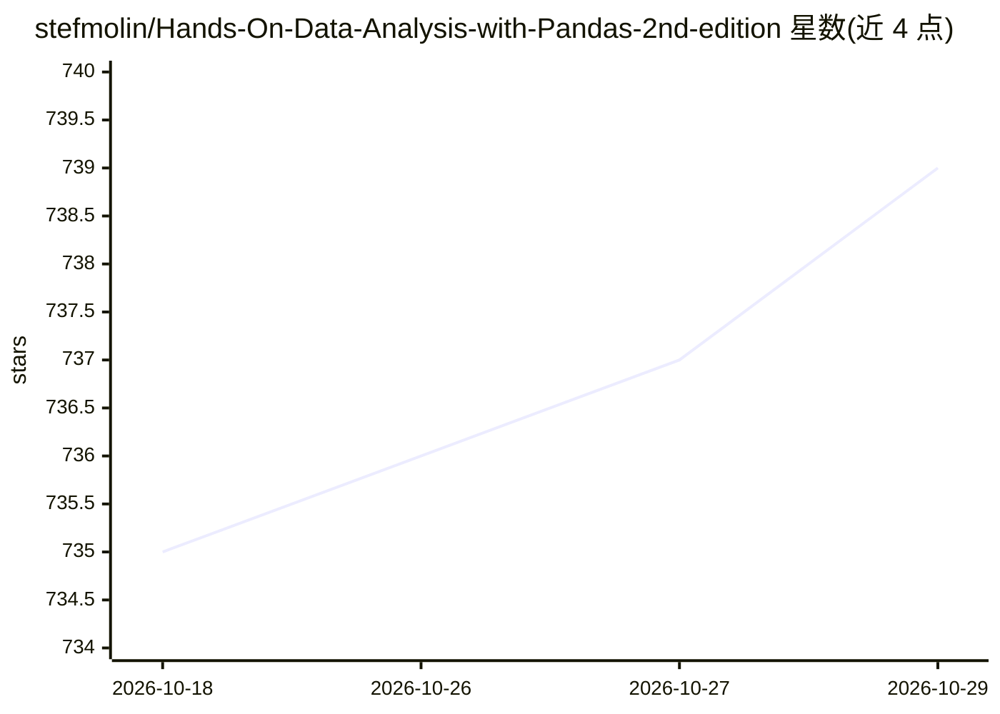

# stefmolin/Hands-On-Data-Analysis-with-Pandas-2nd-edition

⭐ 739 · Jupyter Notebook · MIT · 推送 2026-04-11 · [GitHub](https://github.com/stefmolin/Hands-On-Data-Analysis-with-Pandas-2nd-edition) · [官网](https://www.amazon.com/Hands-Data-Analysis-Pandas-visualization/dp/1800563450) · 个人维护

**《Hands-On Data Analysis with Pandas》第二版配套代码仓库**

Packt 出版图书的官方代码仓库，提供全部章节的 Jupyter notebook 材料、真实数据集与各章练习（第 1-11 章附解答）。内容涵盖 pandas/NumPy 数据清洗与重塑、matplotlib/seaborn 可视化、scikit-learn 的异常检测/回归/聚类/分类等机器学习应用。环境要求 Python >= 3.7 且 < 3.10，通过 requirements.txt 或 environment.yml（conda）安装依赖，也可在 Binder 或 Google Colab 上运行；含 1st/2nd 版本两个 git 标签。

## 筛选速览

| 维度 | 判定 | 备注 |
|---|---|---|
| AI 角色 | `ai-knowledge` | 知识聚合/清单类 |
| 许可风险 | `permissive` | MIT |
| 部署形态 | `None` |  |
| 模型依赖 | — | README 未给出锁定关系 |
| 硬件要求 | — | 无带数字的原话,不猜 |
| 安装摩擦 | `low` | 无编译、无系统依赖或容器化 |
| 成熟度 | — | 结构信号不足 |

## 能力要点

- 全部章节的 Jupyter notebook 与真实数据集
- 第 1-11 章练习附解答，第 12 章为开放式练习
- 支持 conda（environment.yml）与 pip（requirements.txt）两种环境搭建方式
- 提供 Binder / Google Colab 在线运行选项

## 适用场景

- 跟着书逐步练习 pandas 数据分析与可视化
- 学习用 scikit-learn 做回归、聚类、分类与异常检测
- 在 Binder 或 Colab 上免本地环境运行书中代码

## 场景标签

`教程课程` · 领域:学习与行业

## 证据(README 行号)

> L5: This is the code repository for my book Hands-On Data Analysis with Pandas, published by Packt on July 26, 2019 (1st
> L16: Using real-world datasets, you will learn how to use the pandas library to perform data wrangling to reshape, clean

## 星数曲线

2026-10-18 735 → 2026-10-29 739（+4）

---
*卡片 v1 · prompt 1.4 · 生成 2026-10-21 · 置信度 high · 依据 README sha `acfd1ff03876` · [字段定义](../../DATASET.md)*
