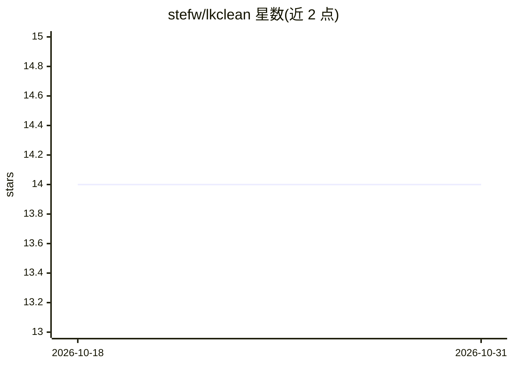

# stefw/lkclean

⭐ 14 · TypeScript · MIT · 推送 2026-09-20 · [GitHub](https://github.com/stefw/lkclean) · 个人维护

**过滤 LinkedIn 信息流的 Chrome 扩展：AI 分类噪音贴文并解释决定**

Manifest V3 + TypeScript 编写的 Chrome 扩展，用 MutationObserver 监听 LinkedIn 信息流，将每条贴文的作者与文本发送到 TypeSafe AI 的 Jev 分类模型（api.typesafe.ai），按点击诱饵、自我宣传、主题匹配等维度返回概率，再由本地代码按用户阈值折叠或标注贴文，并在贴文上展示理由与分数。需自备 TypeSafe API key；贴文文本会发送至该 API。支持从 release zip 加载或源码构建安装，界面目前为法语。

## 筛选速览

| 维度 | 判定 | 备注 |
|---|---|---|
| AI 角色 | `ai-native` | 本体是模型或模型工具 |
| 许可风险 | `permissive` | MIT |
| 部署形态 | `desktop` | 安装包/桌面程序 |
| 模型依赖 | — | README 未给出锁定关系 |
| 硬件要求 | — | 无带数字的原话,不猜 |
| 安装摩擦 | `low` | 无编译、无系统依赖或容器化 |
| 成熟度 | — | 结构信号不足 |

## 能力要点

- 每条贴文一次 API 调用，多问题并行评估，判定按会话缓存
- 隐藏贴文展示理由与分数，保留贴文显示 'Kept by Jev' 及分数
- 活动徽章显示已分析/隐藏数、tokens、估算成本与延迟
- API key 仅存于 service worker，不发往 LinkedIn 页面

## 适用场景

- 隐藏 LinkedIn 信息流中的点击诱饵、自我宣传与赞助贴文
- 按自定义兴趣清单过滤无关内容并调整阈值
- 查看每条贴文的过滤理由与概率分数

## 场景标签

 · 领域:浏览器扩展/内容过滤

## 证据(README 行号)

> L6: Every post is sent to **Jev**, the typed classification model from
> L8: Engagement bait, self-promotion, off-topic and sponsored posts are collapsed into

## 星数曲线

2026-10-18 14 → 2026-10-31 14（+0）

---
*卡片 v1 · prompt 1.4 · 生成 2026-10-31 · 置信度 high · 依据 README sha `391d2b5a2368` · [字段定义](../../DATASET.md)*
