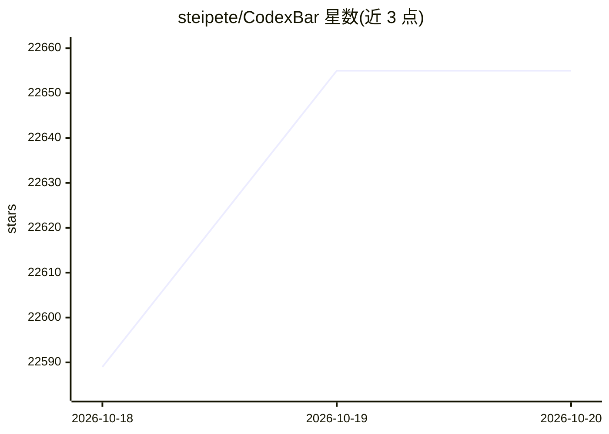

# steipete/CodexBar

⭐ 22,655 · Swift · MIT · 推送 2026-10-19 · [GitHub](https://github.com/steipete/CodexBar) · [官网](https://codex.bar) · 个人维护

**给 AI 编码用户在菜单栏显示各家服务商用量与额度**

一个 macOS 14+ 菜单栏应用（另有 Qt 6 Linux 桌面版与 CLI），聚合 106 个 AI 编码服务商的用量数据：会话/周/月窗口余量、重置倒计时、余额与支出、服务状态徽标。不要求单独登录，复用用户已有的 OAuth、设备流、API key、浏览器 Cookie 或本地文件会话读取用量；每服务商一个图标或合并模式，配置存于 ~/.config/codexbar/config.json，可用 CLI 脚本化管理。通过 Homebrew、AUR 或 GitHub Releases 分发。

## 筛选速览

| 维度 | 判定 | 备注 |
|---|---|---|
| AI 角色 | `ai-ecosystem` | LLM/agent 周边工具 |
| 许可风险 | `permissive` | MIT |
| 部署形态 | `None` |  |
| 模型依赖 | local-ok | 支持本地模型 |
| 硬件要求 | — | 无带数字的原话,不猜 |
| 安装摩擦 | `low` | 无编译、无系统依赖或容器化 |
| 成熟度 | — | 结构信号不足 |

## 动量与使用信号

- 维护:`active` — 距上次 push 1.2 天,年发版 100,428 位贡献者
- 涨星:近 1 天 **+30**(自 20261016 起算)
- 平台:WINDOWS / MACOS / LINUX · 协议:MCP / OLLAMA

## 能力要点

- 聚合 106 个 AI 编码服务商的额度/用量/余额数据
- 复用已有会话读取数据，不存储密码
- 会话、周、月窗口的重置倒计时与服务状态徽标
- macOS 菜单栏、Linux 桌面（Wayland/X11）与 CLI 三种形态

## 适用场景

- 在长任务前确认各家订阅的用量窗口何时重置
- 统一查看多个 AI 编码订阅的余额与支出
- 监控服务商故障状态并在菜单栏获得提示

## 场景标签

`LLM 可观测性` · 领域:评测与运维

## 证据(README 行号)

> L13: CodexBar — every AI coding limit in your menu bar. 106 providers.
> L15: Tiny macOS 14+ menu bar app that keeps **AI coding-provider limits visible** and shows when each window resets. See
> L26: - **Privacy-first.** Reuses existing provider sessions — OAuth, device flow, API keys, browser cookies, local files

## 星数曲线

2026-10-18 22,589 → 2026-10-20 22,655（+66）

---
*卡片 v1 · prompt 1.4 · 生成 2026-10-18 · 置信度 high · 依据 README sha `efe917a8dbeb` · [字段定义](../../DATASET.md)*
