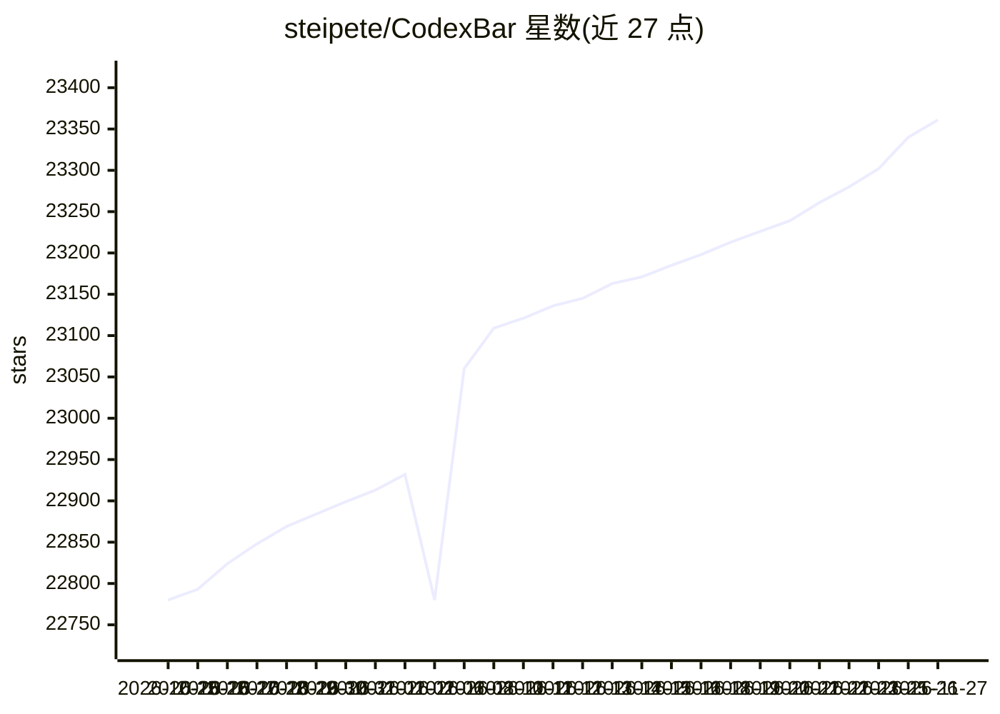

# steipete/CodexBar

⭐ 23,361 · Swift · MIT · 推送 2026-11-21 · [GitHub](https://github.com/steipete/CodexBar) · [官网](https://codex.bar) · 个人维护

**在菜单栏显示各 AI 编程服务商用量与重置时间的工具**

面向 AI 编程服务用户的状态监测工具，以 macOS 菜单栏应用或 Linux 桌面应用/CLI 形式运行，覆盖 115 个 provider 的会话、周、月用量窗口与重置倒计时，并读取余额、消费与账单数据。复用已有的 OAuth、API key、浏览器 cookie、本地文件等会话来源，不存储密码；支持状态轮询出事故徽标、每 provider 独立图标或合并模式。macOS 需 14+，Linux 桌面版依赖 Qt 6.4+ 与 glibc 2.39+。

## 筛选速览

| 维度 | 判定 | 备注 |
|---|---|---|
| AI 角色 | `ai-ecosystem` | LLM/agent 周边工具 |
| 许可风险 | `permissive` | MIT |
| 部署形态 | `None` |  |
| 模型依赖 | local-ok | 支持本地模型 |
| 硬件要求 | — | 无带数字的原话,不猜 |
| 安装摩擦 | `low` | 无编译、无系统依赖或容器化 |
| 成熟度 | — | 结构信号不足 |

## 动量与使用信号

- 维护:`active` — 距上次 push 1.2 天,年发版 100,428 位贡献者
- 涨星:近 1 天 **+30**(自 20261016 起算)
- 平台:WINDOWS / MACOS / LINUX · 协议:MCP / OLLAMA

## 能力要点

- 监测 115 个 AI 编程服务商的用量与重置窗口
- 复用已有会话（OAuth/API key/cookie/本地文件），不存储密码
- 提供菜单栏应用、Linux 桌面应用与 CLI 三种形态
- 支持余额/消费追踪与 API key 的 CLI 配置

## 适用场景

- 规划长任务前确认各服务商额度何时重置
- 同时使用多个 AI 编程订阅时统一查看用量
- 追踪各家 API 余额与月度消费

## 场景标签

 · 领域:开发者工具/AI 服务用量监控

## 证据(README 行号)

> L15: Tiny macOS 14+ menu bar app that keeps **AI coding-provider limits visible** and shows when each window resets. See
> L23: - **Plan around resets.** Per-provider session, weekly, and monthly windows with countdowns to the next reset — sto

## 星数曲线

2026-10-25 22,780 → 2026-11-27 23,361（+581）

---
*卡片 v1 · prompt 1.4 · 生成 2026-11-22 · 置信度 high · 依据 README sha `b5637bda8cc0` · [字段定义](../../DATASET.md)*
