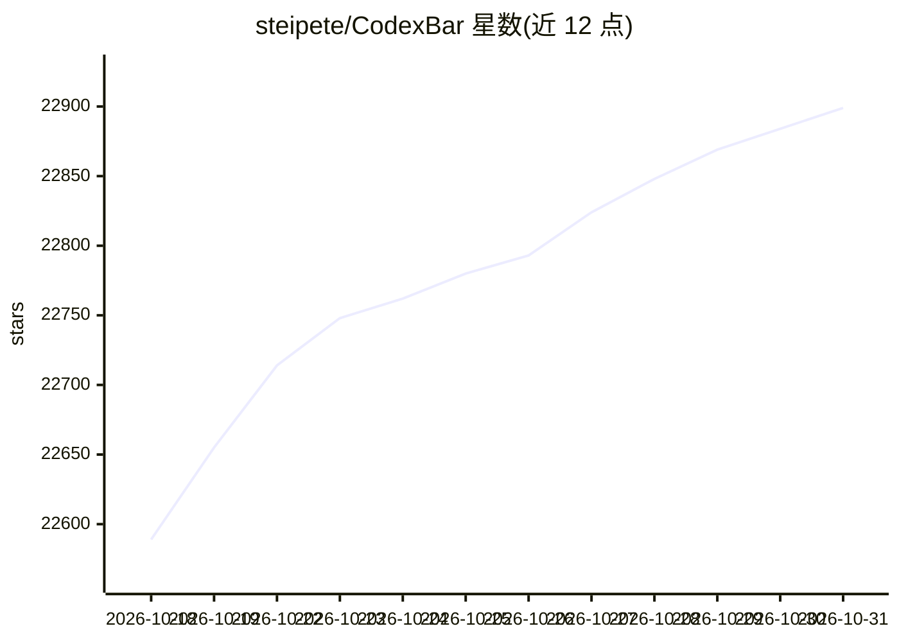

# steipete/CodexBar

⭐ 22,899 · Swift · MIT · 推送 2026-10-30 · [GitHub](https://github.com/steipete/CodexBar) · [官网](https://codex.bar) · 个人维护

**macOS 菜单栏/Linux 桌面应用：集中显示 106 个 AI 编程服务的用量与限额**

面向使用多家 AI 编程服务的开发者：在 macOS 14+ 菜单栏（或 Qt 6 Linux 桌面应用/Omarchy 部件）中常驻显示各服务的会话、周/月用量窗口与重置倒计时，支持信用余额、花费面板、提供商状态轮询与事故徽标。认证复用已有会话（OAuth、API key、浏览器 cookie、本地文件），不存储密码。macOS 经 Homebrew cask 或 GitHub Releases 安装，Linux 需 glibc 2.39+、Qt 6.4+ 与另行安装的 CLI。

## 筛选速览

| 维度 | 判定 | 备注 |
|---|---|---|
| AI 角色 | `ai-ecosystem` | LLM/agent 周边工具 |
| 许可风险 | `permissive` | MIT |
| 部署形态 | `None` |  |
| 模型依赖 | local-ok | 支持本地模型 |
| 硬件要求 | — | 无带数字的原话,不猜 |
| 安装摩擦 | `low` | 无编译、无系统依赖或容器化 |
| 成熟度 | — | 结构信号不足 |

## 动量与使用信号

- 维护:`active` — 距上次 push 1.2 天,年发版 100,428 位贡献者
- 涨星:近 1 天 **+30**(自 20261016 起算)
- 平台:WINDOWS / MACOS / LINUX · 协议:MCP / OLLAMA

## 能力要点

- 106 个提供商的限额/用量窗口与重置倒计时
- 复用已有会话认证（OAuth/API key/浏览器 cookie/本地文件），不存密码
- Admin API 花费面板、信用余额与提供商状态轮询
- macOS（Homebrew cask）与 Linux 桌面（x86_64/ARM64，含 musl 静态包）双平台

## 适用场景

- 同时订阅多个 AI 编程服务，想在菜单栏一眼看到各家剩余额度
- 长任务前确认限额窗口与重置时间
- 通过 CLI 脚本批量配置提供商与 API key

## 场景标签

 · 领域:AI 编程服务监控/开发者工具

## 证据(README 行号)

> L13: CodexBar — every AI coding limit in your menu bar. 106 providers.
> L15: Tiny macOS 14+ menu bar app that keeps **AI coding-provider limits visible** and shows when each window resets. See
> L23: - **Plan around resets.** Per-provider session, weekly, and monthly windows with countdowns to the next reset — sto

## 星数曲线

2026-10-18 22,589 → 2026-10-31 22,899（+310）

---
*卡片 v1 · prompt 1.4 · 生成 2026-10-20 · 置信度 high · 依据 README sha `890976b21c7b` · [字段定义](../../DATASET.md)*
