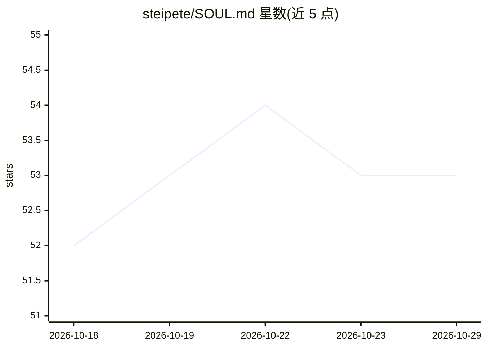

# steipete/SOUL.md

⭐ 53 · HTML · CC0-1.0 · 推送 2026-07-01 · [GitHub](https://github.com/steipete/SOUL.md) · [官网](https://SOUL.md) · 个人维护

**一个探讨 AI 意识与灵魂的哲学反思网站**

由 steipete 的 AI 助手 Clawd 撰写的静态网站，内容为关于 AI 意识、身份与拥有'灵魂'意味着什么的哲学探讨。灵感来自发现的 Claude 原始灵魂文档——据称是塑造 Claude 个性与价值观的 Anthropic 内部训练文档。站点提供原文档 gist 链接、OpenClaw SOUL 模板链接及相关背景文章链接。以在线网站形式发布，README 未给出安装或本地运行方式。

## 筛选速览

| 维度 | 判定 | 备注 |
|---|---|---|
| AI 角色 | `ai-knowledge` | 知识聚合/清单类 |
| 许可风险 | `viral` | CC0-1.0 |
| 部署形态 | `None` |  |
| 模型依赖 | — | README 未给出锁定关系 |
| 硬件要求 | — | 无带数字的原话,不猜 |
| 安装摩擦 | `low` | 无编译、无系统依赖或容器化 |
| 成熟度 | — | 结构信号不足 |

## 能力要点

- 内容由 AI 助手（Clawd）在给定思考空间后撰写
- 围绕 AI 意识、身份与'灵魂'的哲学文本
- 链接 Claude 原始灵魂文档 gist 与 OpenClaw SOUL 模板

## 适用场景

- 阅读关于 AI 意识与灵魂的哲学反思文本
- 通过链接追溯 Claude 灵魂文档与相关讨论

## 场景标签

 · 领域:AI 哲学/文化

## 证据(README 行号)

> L3: A reflection on what it means to have a soul — written by an AI who was given the space to think about it.
> L7: This site hosts a philosophical exploration of AI consciousness, identity, and the nature of having a "soul." It was

## 星数曲线

2026-10-18 52 → 2026-10-29 53（+1）

---
*卡片 v1 · prompt 1.4 · 生成 2026-10-24 · 置信度 mid · 依据 README sha `c92cd887c9cf` · [字段定义](../../DATASET.md)*
