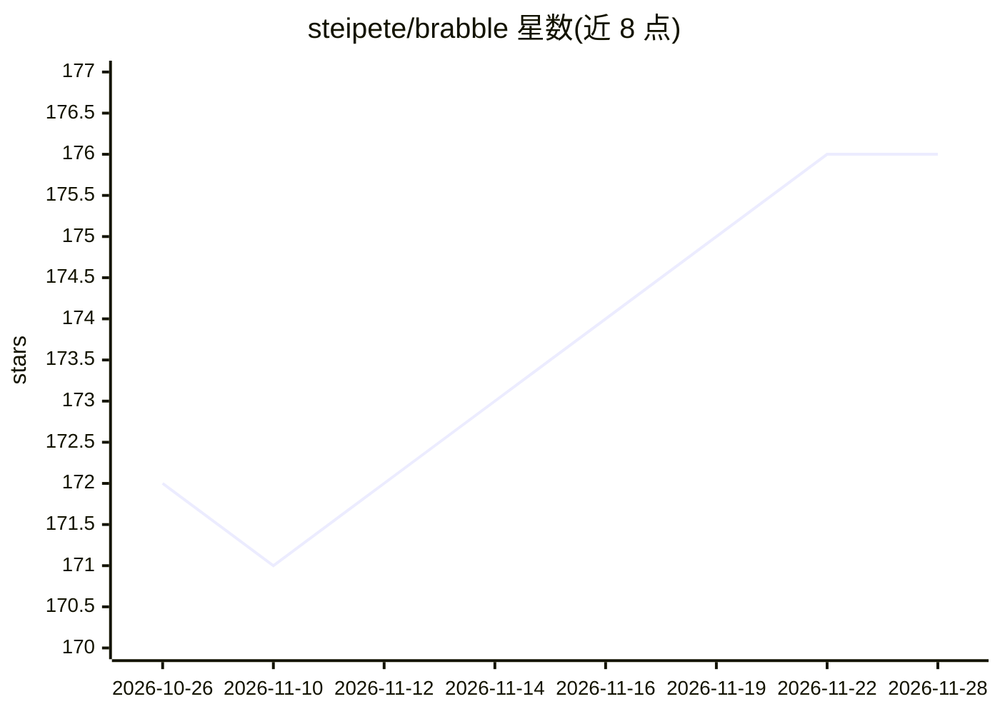

# steipete/brabble

⭐ 176 · Go · MIT · 推送 2026-11-16 · [GitHub](https://github.com/steipete/brabble) · [官网](https://brabble.dev) · 个人维护

**macOS/Linux 本地常驻语音守护进程：唤醒词转写并触发命令**

以 Go 编写的常驻语音守护进程，监听唤醒词（默认 "clawd"）后用 whisper.cpp 本地转写，再触发用户定义的 hook（如 warelay 心跳命令）。音频链路为 PortAudio 采集加 WebRTC VAD 分段，支持 partial 转写日志、队列/超时/冷却防刷、PII 掩码开关、Prometheus 指标端点。提供 daemon 生命周期管理、UNIX socket 状态查询、模型下载管理、launchd/systemd 服务安装及 WAV 文件离线转写命令。

## 筛选速览

| 维度 | 判定 | 备注 |
|---|---|---|
| AI 角色 | `ai-native` | 本体是模型或模型工具 |
| 许可风险 | `permissive` | MIT |
| 部署形态 | `None` |  |
| 模型依赖 | — | README 未给出锁定关系 |
| 硬件要求 | — | 无带数字的原话,不猜 |
| 安装摩擦 | `medium` | 含编译或系统依赖之一 |
| 成熟度 | — | 结构信号不足 |

## 能力要点

- whisper.cpp 本地转写，支持 5 档 ggml 模型管理与下载
- 唤醒词过滤、WebRTC VAD 分段、队列+冷却防刷机制
- launchd/systemd 服务安装与 UNIX socket 状态查询
- WAV 文件离线转写并可选经 hook 分发

## 适用场景

- 语音说出唤醒词后让 agent 执行命令
- 需要本地化、不出网的语音转写场景
- 把语音输入接入自定义 hook 工作流

## 场景标签

`语音识别` · 领域:感知与多模态

## 证据(README 行号)

> L3: Always-on, local-only voice daemon for macOS and Linux. Hears your wake word (“clawd” by default), transcribes with 
> L29: - `transcribe <wav>` — run whisper on a WAV file; add `--hook` to send it through your configured hook (respects wa
> L60: - PortAudio capture → WebRTC VAD → partial segments every `partial_flush_ms` (suppressed from hook) → final segment

## 星数曲线

2026-10-26 172 → 2026-11-28 176（+4）

---
*卡片 v1 · prompt 1.4 · 生成 2026-11-26 · 置信度 high · 依据 README sha `efcede2f0c28` · [字段定义](../../DATASET.md)*
