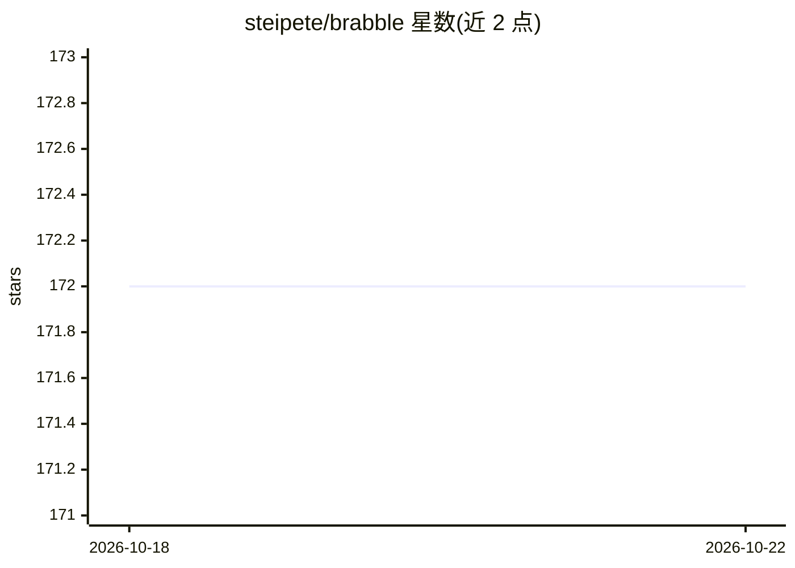

# steipete/brabble

⭐ 171 · Go · MIT · 推送 2026-10-21 · [GitHub](https://github.com/steipete/brabble) · [官网](https://brabble.dev) · 个人维护

**macOS/Linux 本地常驻语音唤醒守护进程，转写后触发自定义命令**

用 Go 编写的本地语音守护进程：通过 PortAudio 采集麦克风音频，经 WebRTC VAD 切分语音段，用 whisper.cpp 转写，识别唤醒词（默认 "clawd"，也接受 "Claude"）后触发用户自定义 hook 命令（如 warelay 发送消息），支持队列、冷却、超时与 PII 脱敏。全程本地运行，提供 CLI 管理守护进程生命周期、麦克风、模型下载与 launchd/systemd 服务安装，并有 Prometheus 指标端点。macOS 14+ 提供签名公证的发布包，Intel Mac 与 Linux 需从源码构建（需自行编译 whisper.cpp）。

## 筛选速览

| 维度 | 判定 | 备注 |
|---|---|---|
| AI 角色 | `ai-native` | 本体是模型或模型工具 |
| 许可风险 | `permissive` | MIT |
| 部署形态 | `None` |  |
| 模型依赖 | — | README 未给出锁定关系 |
| 硬件要求 | — | 无带数字的原话,不猜 |
| 安装摩擦 | `medium` | 含编译或系统依赖之一 |
| 成熟度 | — | 结构信号不足 |

## 能力要点

- PortAudio 采集 + WebRTC VAD + whisper.cpp 本地转写链路
- 唤醒词触发用户自定义 hook，支持队列/冷却/超时/PII 脱敏
- 守护进程生命周期 CLI、launchd/systemd 服务安装、Prometheus 指标端点
- macOS 发布包经 Developer ID 签名并公证

## 适用场景

- 对着麦克风说唤醒词来触发本地命令或脚本
- 为 agent 提供常驻的本地语音入口
- 无守护进程状态下用 transcribe 命令离线转写 WAV 文件

## 场景标签

 · 领域:语音交互/桌面工具

## 证据(README 行号)

> L3: Always-on, local-only voice daemon for macOS and Linux. Hears your wake word (“clawd” by default), transcribes with 
> L61: - Wake word (case-insensitive) is stripped before dispatch; disable with `--no-wake` or `BRABBLE_WAKE_ENABLED=0`. I

## 星数曲线

2026-10-18 172 → 2026-10-22 172（+0）

---
*卡片 v1 · prompt 1.4 · 生成 2026-10-22 · 置信度 high · 依据 README sha `43650b81645e` · [字段定义](../../DATASET.md)*
