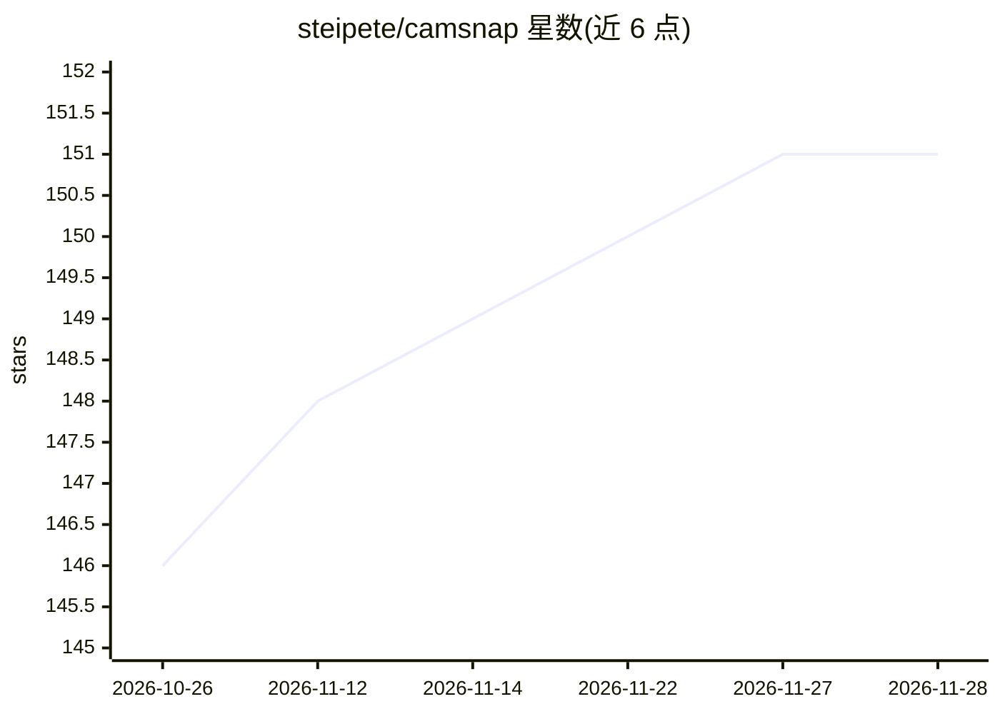

# steipete/camsnap

⭐ 151 · Go · MIT · 推送 2026-11-16 · [GitHub](https://github.com/steipete/camsnap) · [官网](https://camsnap.ai) · 个人维护

**从 RTSP/ONVIF 摄像头抓取快照与短片的 CLI 工具**

命令行工具，功能包括：向 RTSP 摄像头抓取快照与短片、发现局域网内 ONVIF 设备、基于 ffmpeg 场景变化检测触发 shell 动作、macOS/Linux 本地摄像头抓取与 PTZ 控制。摄像头保存一次后可按名称调用。配置以明文存储于 ~/.config 下的 YAML 文件。macOS/Linux 提供 Homebrew 安装，三平台提供预编译二进制，也可容器运行或源码构建（需 Go 1.27+）。Windows 支持网络摄像头但不支持本地摄像头。

## 筛选速览

| 维度 | 判定 | 备注 |
|---|---|---|
| AI 角色 | `ai-enhanced` | 去掉 AI 部分产品仍成立 |
| 许可风险 | `permissive` | MIT |
| 部署形态 | `None` |  |
| 模型依赖 | — | README 未给出锁定关系 |
| 硬件要求 | — | 无带数字的原话,不猜 |
| 安装摩擦 | `medium` | 含编译或系统依赖之一 |
| 成熟度 | — | 结构信号不足 |

## 能力要点

- 抓取 RTSP 快照/短片，支持 TCP/UDP 传输与自定义流路径
- watch 命令基于 ffmpeg 场景变化检测触发 shell 动作（带冷却与 JSON 输出）
- ONVIF 设备发现与 doctor 连通性/认证诊断
- macOS 原生 AVFoundation 快照与 PTZ 控制，Linux 走 v4l2/ffmpeg

## 适用场景

- 定时或按需从监控摄像头抓取画面帧
- 检测到画面变化时触发自定义脚本动作
- 局域网内发现并诊断 ONVIF 摄像头
- 本地网络摄像头拍照与 PTZ 云台控制

## 场景标签

 · 领域:监控/视频采集工具

## 证据(README 行号)

> L9: camsnap is a command-line tool for capturing snapshots and short clips from RTSP cameras, discovering ONVIF devices,
> L19: ## Install

## 星数曲线

2026-10-26 146 → 2026-11-28 151（+5）

---
*卡片 v1 · prompt 1.4 · 生成 2026-11-27 · 置信度 high · 依据 README sha `30b0d2947ba4` · [字段定义](../../DATASET.md)*
