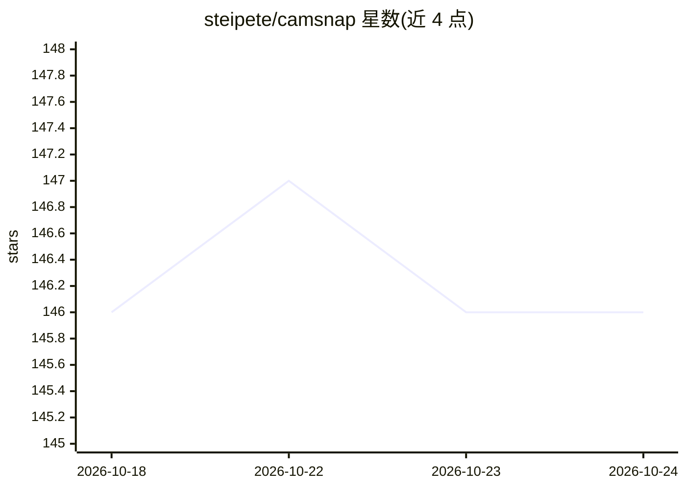

# steipete/camsnap

⭐ 146 · Go · MIT · 推送 2026-10-24 · [GitHub](https://github.com/steipete/camsnap) · [官网](https://camsnap.ai) · 个人维护

**给开发者的摄像头命令行工具：抓拍、录像与场景变化触发动作**

camsnap 是一个 Go 编写的命令行工具，面向需要从 RTSP/RTSPS 网络摄像头或本地摄像头抓拍快照、录制短视频的用户。支持按名称保存摄像头配置、ONVIF 设备发现、USB 摄像头 PTZ 控制与 macOS 下的 pan 弧线扫描抓帧。watch 命令基于 ffmpeg 的场景变化检测（可设阈值与冷却时间）触发任意 shell 动作，并以 JSON 流输出事件。macOS/Linux/Windows 提供预编译二进制，Homebrew 安装自动携带 ffmpeg；Windows 不支持本地摄像头，配置文件明文存储凭据。

## 筛选速览

| 维度 | 判定 | 备注 |
|---|---|---|
| AI 角色 | `ai-enhanced` | 去掉 AI 部分产品仍成立 |
| 许可风险 | `permissive` | MIT |
| 部署形态 | `None` |  |
| 模型依赖 | — | README 未给出锁定关系 |
| 硬件要求 | — | 无带数字的原话,不猜 |
| 安装摩擦 | `medium` | 含编译或系统依赖之一 |
| 成熟度 | — | 结构信号不足 |

## 能力要点

- 按名称管理 RTSP/本地摄像头，支持 snap/clip/watch/discover/ptz/sweep 等命令
- watch 基于 ffmpeg 场景变化检测触发 shell 动作，支持阈值、冷却与 JSON 事件流
- ONVIF 设备发现与连接诊断（doctor 区分认证/网络/权限故障）
- macOS 原生 AVFoundation 采集与 PTZ 扫描抓帧（sweep 输出 manifest.json）

## 适用场景

- 从家里的 RTSP 摄像头定时抓帧或录制短片
- 画面变化时自动执行脚本（如通知或录像联动）
- 扫描局域网内的 ONVIF 摄像头并做连接诊断

## 场景标签

`图像视频处理` · 领域:感知与多模态

## 证据(README 行号)

> L9: camsnap is a command-line tool for capturing snapshots and short clips from RTSP cameras, discovering ONVIF devices,
> L85: `watch` uses ffmpeg scene-change detection and applies a cooldown between actions:

## 星数曲线

2026-10-18 146 → 2026-10-24 146（+0）

---
*卡片 v1 · prompt 1.4 · 生成 2026-10-22 · 置信度 mid · 依据 README sha `1d38474bcc2d` · [字段定义](../../DATASET.md)*
