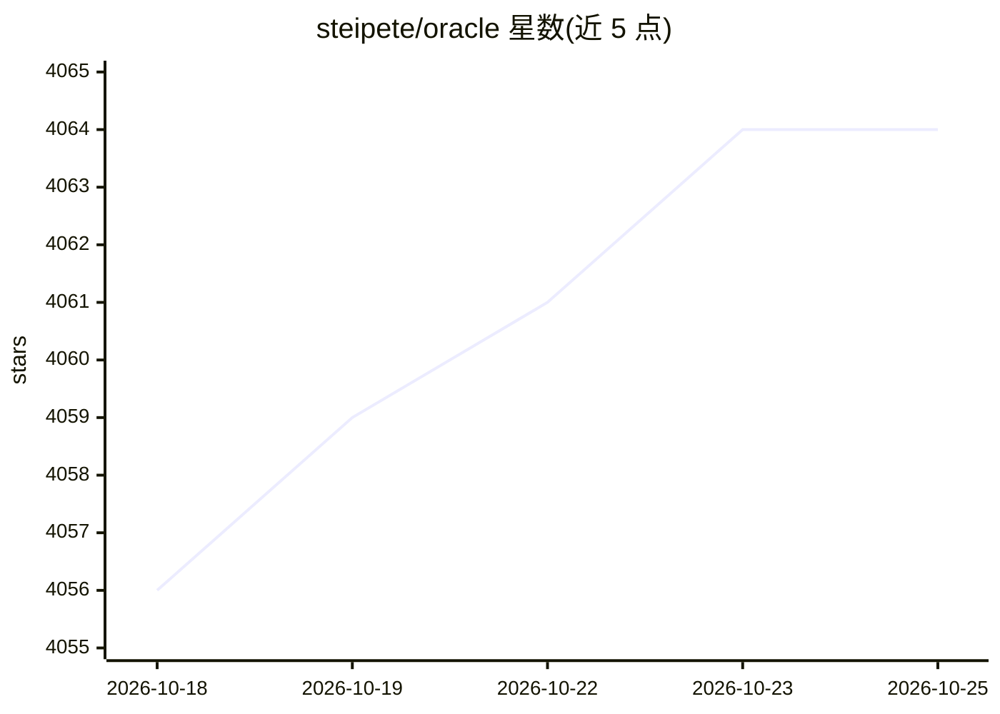

# steipete/oracle

⭐ 4,062 · TypeScript · MIT · 推送 2026-10-23 · [GitHub](https://github.com/steipete/oracle) · [官网](https://askoracle.sh) · 个人维护

**把选定文件打包发给 AI 模型做二次评审的 CLI 与 MCP 服务器**

面向开发者和编码 agent 的命令行工具：用 --file 组合文件、目录、glob 与排除规则，把提示词与项目文件打包后经 API（OpenAI/Azure/Anthropic/Gemini/xAI/OpenRouter）或已登录浏览器（ChatGPT/Gemini）发送给模型，结果以会话形式存储在 ~/.oracle/sessions，支持后台完成、重放、追问与 --models 多模型面板。--render/--dry-run 可在无凭证、不联网模型的情况下预览精确 prompt 与 token 估算；另提供 oracle-mcp stdio 服务器供 Claude Code、Cursor 等 MCP 客户端集成。需 Node.js 24+。

## 筛选速览

| 维度 | 判定 | 备注 |
|---|---|---|
| AI 角色 | `ai-ecosystem` | LLM/agent 周边工具 |
| 许可风险 | `permissive` | MIT |
| 部署形态 | `library` | 以包/库形式分发 |
| 模型依赖 | locked-api |  |
| 硬件要求 | — | 无带数字的原话,不猜 |
| 安装摩擦 | `low` | 无编译、无系统依赖或容器化 |
| 成熟度 | — | 结构信号不足 |

## 能力要点

- API 与浏览器双引擎：无 key 时可用已登录的 ChatGPT/Gemini 浏览器会话
- --render/--dry-run 预览精确 prompt、文件清单与 token 估算，无需凭证
- 会话存储于 ~/.oracle/sessions，支持后台运行、重放与追问
- --models 多模型面板记录用量、成本与部分失败；附 MCP stdio 服务器

## 适用场景

- 让第二个模型基于真实项目文件做代码审查或风险审计
- 为 Claude Code、Cursor 等编码 agent 提供可调用的 MCP 评审工具
- 在同一运行中对比多个模型对同一上下文的回答与成本

## 场景标签

`代码审查` · 领域:编码与开发

## 证据(README 行号)

> L11: Oracle is a CLI and MCP server that bundles a prompt with the files you select, sends that context to an AI model t
> L97: For agent integrations, run the `oracle-mcp` stdio server or install the Oracle skill from this repository. See MCP

## 星数曲线

2026-10-18 4,056 → 2026-10-25 4,064（+8）

---
*卡片 v1 · prompt 1.4 · 生成 2026-10-21 · 置信度 high · 依据 README sha `e86409a5d3dc` · [字段定义](../../DATASET.md)*
