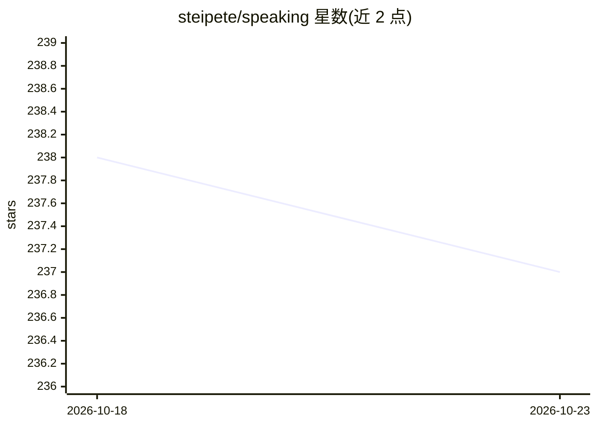

# steipete/speaking

⭐ 237 · MIT · 推送 2026-10-02 · [GitHub](https://github.com/steipete/speaking) · [官网](https://steipete.me) · 个人维护

**Peter Steinberger 的演讲日程与个人资料页（会议清单+Bio）**

个人演讲活动仓库：列出 Peter Steinberger（OpenClaw 创造者、OpenAI 员工）2026 年及未来的会议与聚会日程，附 2025-2026 历史演讲记录（部分带视频链接）、长短版个人简介、SpeakerDeck 幻灯片指引、头像与照片文件夹，以及播客与文章列表。面向会议组织者挑选简介与联系方式使用，不提供可安装或可运行的软件，仅为静态 Markdown 文档。

## 筛选速览

| 维度 | 判定 | 备注 |
|---|---|---|
| AI 角色 | `ai-knowledge` | 知识聚合/清单类 |
| 许可风险 | `permissive` | MIT |
| 部署形态 | `None` |  |
| 模型依赖 | — | README 未给出锁定关系 |
| 硬件要求 | — | 无带数字的原话,不猜 |
| 安装摩擦 | `low` | 无编译、无系统依赖或容器化 |
| 成熟度 | — | 结构信号不足 |

## 能力要点

- 按年份组织的前 upcoming 与 past 演讲日程表，部分条目附视频/文章链接
- 提供长/短/幽默三版可直接引用的个人简介
- 2024 及更早演讲归档于 ARCHIVE.md

## 适用场景

- 会议组织者查看演讲者日程并邀请其演讲
- 查找 Peter Steinberger 历史演讲的视频与幻灯片
- 获取可直接引用的演讲者简介与照片

## 场景标签

 · 领域:个人宣传/活动日程

## 证据(README 行号)

> L5: ## Upcoming Conferences & Meetups in 2026+
> L95: ### Bio

## 星数曲线

2026-10-18 238 → 2026-10-23 237（-1）

---
*卡片 v1 · prompt 1.4 · 生成 2026-10-22 · 置信度 low · 依据 README sha `a0927e8d7716` · [字段定义](../../DATASET.md)*
