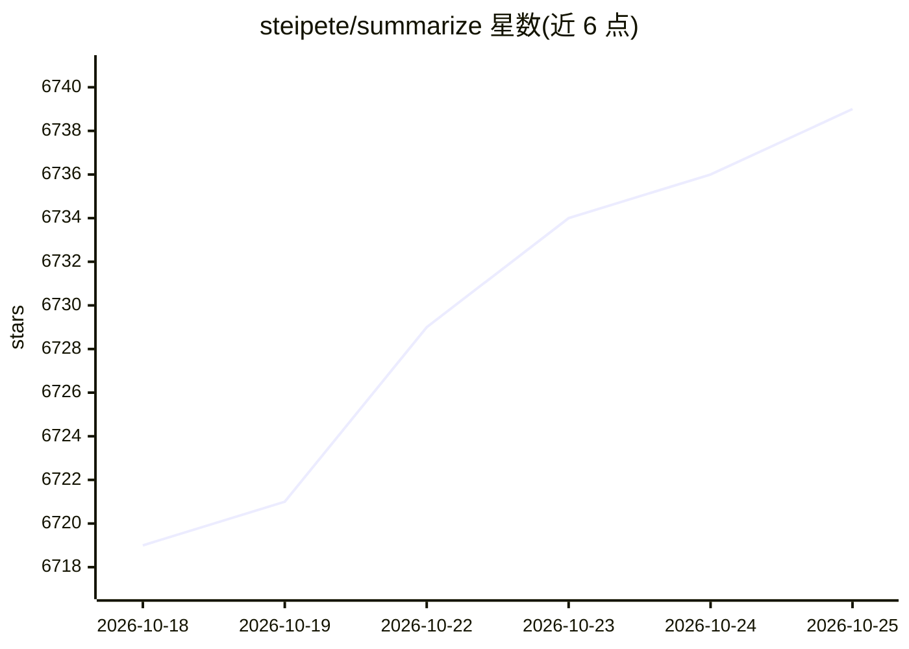

# steipete/summarize

⭐ 6,739 · TypeScript · MIT · 推送 2026-10-23 · [GitHub](https://github.com/steipete/summarize) · [官网](https://summarize.sh) · 个人维护

**CLI 与浏览器扩展：对网页/YouTube/播客/文件提取正文并生成摘要**

TypeScript 编写的摘要工具：从网页（Readability 提取，可回退 Markdown/Firecrawl）、PDF/图片/文本文件、YouTube 与播客（优先已发布字幕/转录稿）、音视频（本地或云端转录，可选说话人标签）提取内容，再经模型生成摘要。--extract 可无 API key 仅取正文。支持 OpenAI 兼容端点、Ollama、OpenRouter、认证编码 CLI（Codex/Claude/Gemini/GitHub Copilot 等）作为提供商；通过 npx/npm/brew 安装 CLI，另有 Chrome 侧栏/Firefox 侧边栏扩展（可直接运行或配对守护进程）。CLI 与扩展界面支持包括简繁体中文在内的 14 种语言，摘要语言独立设置。

## 筛选速览

| 维度 | 判定 | 备注 |
|---|---|---|
| AI 角色 | `ai-native` | 本体是模型或模型工具 |
| 许可风险 | `permissive` | MIT |
| 部署形态 | `library` | 以包/库形式分发 |
| 模型依赖 | local-ok | 支持本地模型 |
| 硬件要求 | — | 无带数字的原话,不猜 |
| 安装摩擦 | `medium` | 含编译或系统依赖之一 |
| 成熟度 | — | 结构信号不足 |

## 能力要点

- 多来源输入：网页/PDF/YouTube/播客/音视频/视频幻灯片帧
- --extract 无 API key 即可提取正文，--json 输出稳定自动化封装
- 提供商可配置：OpenAI 兼容端点、Ollama、OpenRouter、认证编码 CLI
- 14 种界面语言，摘要语言独立指定

## 适用场景

- 快速获取网页文章或 YouTube 视频的要点
- 本地模型或自有 API key 批量总结播客与文档
- 在浏览器侧边栏总结当前标签页并与其内容对话

## 场景标签

`AI 写作` `文档问答` · 领域:内容生成

## 证据(README 行号)

> L8: Summarize extracts clean text and produces summaries from web pages, files, YouTube videos, podcasts, and other audi
> L104: Model IDs use `provider/model` names. Summarize works with configured API providers, OpenAI-compatible endpoints, 

## 星数曲线

2026-10-18 6,719 → 2026-10-25 6,739（+20）

---
*卡片 v1 · prompt 1.4 · 生成 2026-10-20 · 置信度 high · 依据 README sha `ff198efcc8b3` · [字段定义](../../DATASET.md)*
