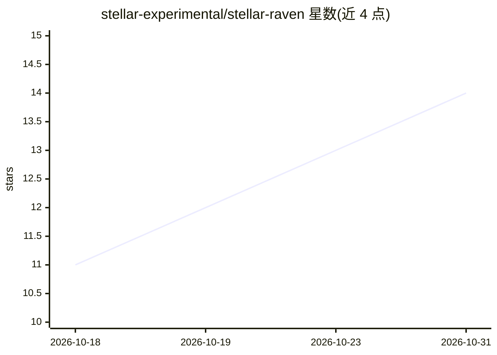

# stellar-experimental/stellar-raven

⭐ 14 · JavaScript · Apache-2.0 · 推送 2026-10-29 · [GitHub](https://github.com/stellar-experimental/stellar-raven) · [官网](https://raven.stellar.org) · 组织维护

**面向 AI agent 的 Stellar 生态远程 MCP 服务器（文档与数据网关）**

部署在 Cloudflare Workers 上的远程 MCP 服务器，为 AI agent 提供统一鉴权网关，接入 Stellar 官方文档搜索索引、Lumenloop API、Stellar Light/Scout 只读 API 及多个生态技能库。提供两个工具：search 检索服务操作与技能，execute 在无网络访问的 Dynamic Worker 隔离沙箱中运行 agent 编写的 JavaScript，服务端适配器持有密钥。OAuth 授权（WorkOS AuthKit），可连接 MCP 客户端或用 Node 24 + npm 本地运行。

## 筛选速览

| 维度 | 判定 | 备注 |
|---|---|---|
| AI 角色 | `ai-ecosystem` | LLM/agent 周边工具 |
| 许可风险 | `permissive` | Apache-2.0 |
| 部署形态 | `None` |  |
| 模型依赖 | — | README 未给出锁定关系 |
| 硬件要求 | — | 无带数字的原话,不猜 |
| 安装摩擦 | `low` | 无编译、无系统依赖或容器化 |
| 成熟度 | — | 结构信号不足 |

## 能力要点

- 单一鉴权入口聚合 Lumenloop、Stellar Light/Scout、Stellar Docs 与生态技能
- execute 工具在无网络沙箱中运行 agent 编写的 JavaScript，密钥由宿主侧持有
- 技能源逐 commit 固定（pin），各自保留许可证
- 自带 OAuth 授权服务器，访问令牌 1 小时有效、可刷新 90 天

## 适用场景

- 让 MCP 客户端中的 agent 查询 Stellar 官方文档与生态数据
- 通过沙箱执行工具对 Stellar 生态数据做程序化处理
- 在本地 Node 24 环境运行并测试该 MCP 服务器

## 场景标签

`语义搜索` · 领域:知识与检索

## 证据(README 行号)

> L5: Stellar Raven is a remote MCP server on Cloudflare Workers. It gives agents two tools over one
> L9: - `search` finds service operations and skills.

## 星数曲线

2026-10-18 11 → 2026-10-31 14（+3）

---
*卡片 v1 · prompt 1.4 · 生成 2026-10-31 · 置信度 high · 依据 README sha `3770452cbdf7` · [字段定义](../../DATASET.md)*
