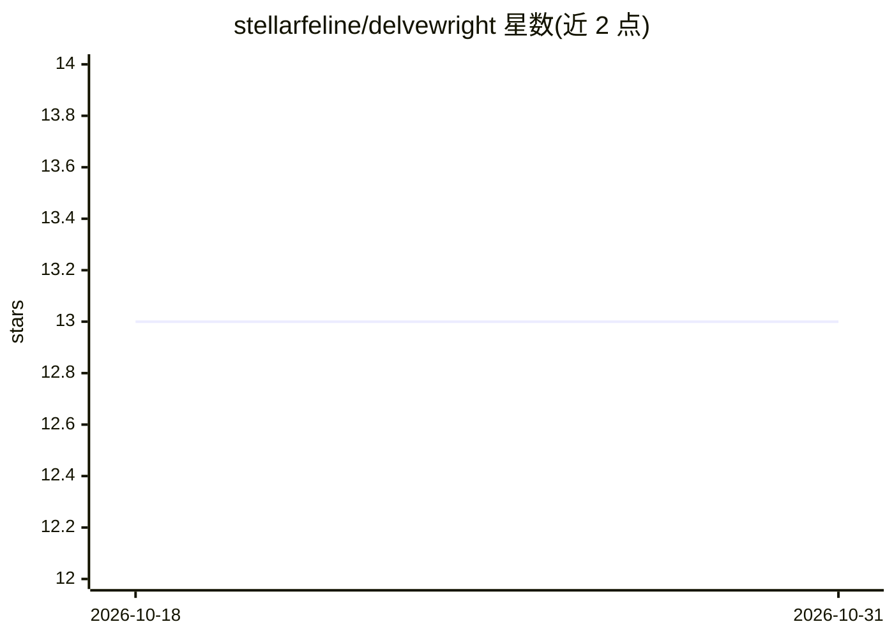

# stellarfeline/delvewright

⭐ 13 · Rust · GPL-3.0 · 推送 2026-10-30 · [GitHub](https://github.com/stellarfeline/delvewright) · 个人维护 · 中文 README

**AI 生成 Minecraft 冒险地图的 Claude Code 技能：提示词进，可玩 RPG 地牢数据包出**

以 Claude Code 插件/技能形式提供的工作流：用户给出创意提示词，agent 生成世界观、NPC、职业、任务计划等经 schema 校验的 JSON 文档，由 Rust 编写的编译器（delvec/dsl，发布于 crates.io）将其编译为含任务与 NPC 的原版数据包，再在本地 Docker Compose 环境构建、校验并通过 localhost:25565 提供游玩。校验链包括静态分析、命令树校验、PackTest 338 项游戏测试、mineflayer 机器人实玩关键路径与全部故事分支、字节级确定性重建。设计阶段设有人工审批门；交付后的地图运行不调用模型。需 git、Python 3.11+、Java 21+、Docker Compose v2。

## 筛选速览

| 维度 | 判定 | 备注 |
|---|---|---|
| AI 角色 | `ai-native` | 本体是模型或模型工具 |
| 许可风险 | `viral` | GPL-3.0 |
| 部署形态 | `self-host` | docker 或自建部署 |
| 模型依赖 | — | README 未给出锁定关系 |
| 硬件要求 | — | 无带数字的原话,不猜 |
| 安装摩擦 | `low` | 无编译、无系统依赖或容器化 |
| 成熟度 | — | 结构信号不足 |

## 能力要点

- 提示词→schema 校验文档→编译为含任务与 NPC 的原版数据包
- 编译器为 Rust 实现（delvec/dsl），发布于 crates.io，确定性输出
- 校验链：静态分析、PackTest 338 项测试、mineflayer 机器人实玩关键路径与四条故事分支
- 以 Claude Code 插件形式安装，一条命令构建/检查/在 localhost:25565 供游玩

## 适用场景

- 想和朋友（1-4 人）游玩自定义剧情 RPG 地牢的 Minecraft 玩家
- 通过对话式提示词快速获得可验证、可通关的冒险地图
- 研究「LLM 生成 + 编译器校验」的可验证内容生成流程

## 场景标签

`代码生成` · 领域:编码与开发

## 证据(README 行号)

> L5: **Delvewright is an AI Minecraft adventure map generator: it turns a creative prompt into a story-driven RPG dungeon
> L24: /delvewright:new-delve a guided tour of a real castle, nine rooms, no combat

## 星数曲线

2026-10-18 13 → 2026-10-31 13（+0）

---
*卡片 v1 · prompt 1.4 · 生成 2026-10-31 · 置信度 mid · 依据 README sha `34206941cd4b` · [字段定义](../../DATASET.md)*
