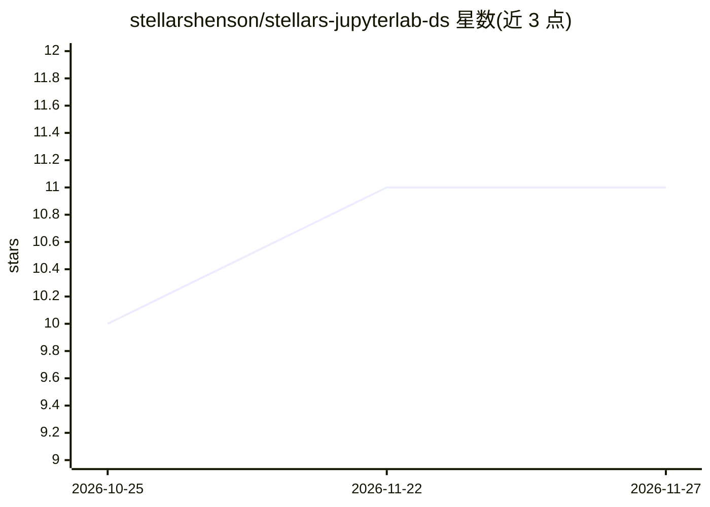

# stellarshenson/stellars-jupyterlab-ds

⭐ 11 · Python · NOASSERTION · 推送 2026-07-11 · [GitHub](https://github.com/stellarshenson/stellars-jupyterlab-ds) · [官网](https://www.linkedin.com/in/konradjelen/) · 个人维护

**为数据科学预配置的 Docker 化 JupyterLab 平台**

基于 Miniforge 3 与 JupyterLab 4 的容器化数据科学环境，通过 docker compose 部署，Traefik 反向代理统一 HTTPS 入口并支持多实例并存。内置预装数据科学包的 base 环境，另可通过 lab-utils 按需安装 TensorFlow、PyTorch、R、Rust 环境；集成 TensorBoard、MLflow、Optuna、系统监控等服务。需 Docker 运行；NVIDIA GPU 为可选项，启动脚本自动检测；多用户场景可接入 stellars-jupyterhub-ds。

## 筛选速览

| 维度 | 判定 | 备注 |
|---|---|---|
| AI 角色 | `ai-enhanced` | 去掉 AI 部分产品仍成立 |
| 许可风险 | `none` | NOASSERTION |
| 部署形态 | `desktop` | 安装包/桌面程序 |
| 模型依赖 | — | README 未给出锁定关系 |
| 硬件要求 | — | 无带数字的原话,不猜 |
| 安装摩擦 | `low` | 无编译、无系统依赖或容器化 |
| 成熟度 | — | 结构信号不足 |

## 能力要点

- Miniforge + JupyterLab 4 预配置镜像，docker compose 一键启动
- TF/PyTorch/R/Rust 环境按需安装，NVIDIA GPU 可选支持
- 集成 MLflow、TensorBoard、Optuna 与 btop 资源监控
- Traefik 域名路由支持多实例并存，提供 Windows/Linux 独立安装器

## 适用场景

- 快速获得带 GPU 的深度学习实验环境
- 单机并行运行多套隔离的 JupyterLab 实例
- 在 notebook 内管理 conda 环境并跟踪实验指标

## 场景标签

`MLOps` · 领域:训练与推理

## 证据(README 行号)

> L11: This project provides a pre-configured JupyterLab environment running on Miniforge with NVIDIA GPU support. It incl
> L126: - GitHub Copilot integration for AI-assisted coding
> L131: - **TensorBoard:** Visualization and monitoring of ML/AI model training metrics (port 6006, logs in `/tmp/tensorbo

## 星数曲线

2026-10-25 10 → 2026-11-27 11（+1）

---
*卡片 v1 · prompt 1.4 · 生成 2026-11-19 · 置信度 high · 依据 README sha `2783cb6e1ed0` · [字段定义](../../DATASET.md)*
