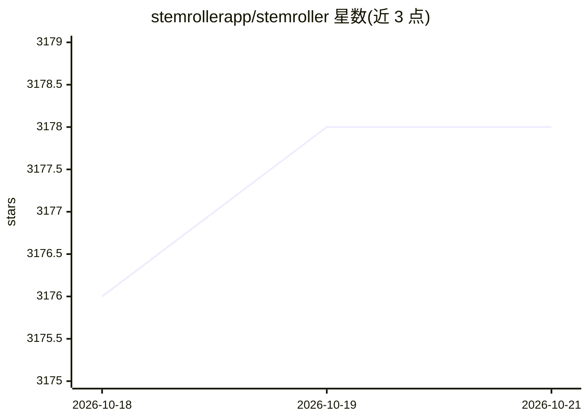

# stemrollerapp/stemroller

⭐ 3,178 · Svelte · NOASSERTION · 推送 2026-06-30 · [GitHub](https://github.com/stemrollerapp/stemroller) · [官网](https://www.stemroller.com) · 组织维护

**一键从任意歌曲分离人声/鼓/贝斯等分轨的桌面应用**

基于 Electron 的免费桌面应用，调用 Facebook 的 Demucs 算法对歌曲做源分离，提取人声、鼓、贝斯及其他乐器分轨，并集成 YouTube 搜索：在搜索栏输入歌名/艺人，点击 Split 即可拆分，数分钟后可打开分轨文件。官网与 releases 页提供打包下载（内含拆分所需组件）；开发模式经 git clone 与 npm 安装依赖后运行，Linux 非官方支持，需自行安装 ffmpeg、demucs、yt-dlp。许可为 Unlicense 或 MIT-0 双选。

## 筛选速览

| 维度 | 判定 | 备注 |
|---|---|---|
| AI 角色 | `ai-native` | 本体是模型或模型工具 |
| 许可风险 | `none` | NOASSERTION |
| 部署形态 | `desktop` | 安装包/桌面程序 |
| 模型依赖 | — | README 未给出锁定关系 |
| 硬件要求 | — | 无带数字的原话,不猜 |
| 安装摩擦 | `medium` | 含编译或系统依赖之一 |
| 成熟度 | — | 结构信号不足 |

## 能力要点

- 使用 Demucs 算法做人声/乐器源分离
- 集成 YouTube 搜索，输入歌名即可拆分
- 官网提供含全部所需组件的打包下载

## 适用场景

- 我想把喜欢的歌拆成人声和伴奏分轨
- 为翻唱或 remix 提取鼓、贝斯等单独音轨
- 不想配置命令行环境，直接下载即用的分轨工具

## 场景标签

 · 领域:音频处理/音乐

## 证据(README 行号)

> L3: StemRoller is the first free app which enables you to separate vocal and instrumental stems from any song with a sin
> L27: Install `ffmpeg` globally using your preferred package manager, and install `demucs` and `yt-dlp` globally with `pi

## 星数曲线

2026-10-18 3,176 → 2026-10-21 3,178（+2）

---
*卡片 v1 · prompt 1.4 · 生成 2026-10-20 · 置信度 high · 依据 README sha `9ae09844313a` · [字段定义](../../DATASET.md)*
