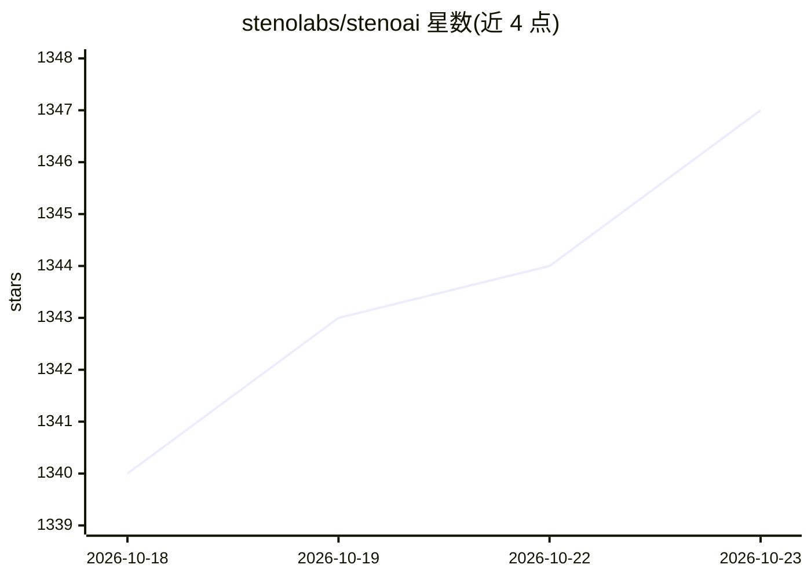

# stenolabs/stenoai

⭐ 1,347 · Python · MIT · 推送 2026-10-22 · [GitHub](https://github.com/stenolabs/stenoai) · [官网](https://stenoai.co/) · 组织维护

**隐私优先的本地 AI 会议记录应用，供保密场合录音转写与摘要**

面向政府、国防及高管等保密需求的桌面 AI 记事应用：在设备本地完成录音、实时转写（Apple Silicon 上用 Parakeet TDT v3，Whisper Large V3 Turbo 处理更多语言）、说话人分离与摘要（默认经 Ollama 运行 gemma4 等模型），输出可编辑的 Markdown 笔记，支持笔记问答与图表。云端模型（OpenAI/Anthropic/Bedrock/自定义端点）为可选项。macOS 提供 DMG 安装（Apple Silicon，macOS 14.4+），Windows 10/11 x64 为 alpha 版本。

## 筛选速览

| 维度 | 判定 | 备注 |
|---|---|---|
| AI 角色 | `ai-native` | 本体是模型或模型工具 |
| 许可风险 | `permissive` | MIT |
| 部署形态 | `desktop` | 安装包/桌面程序 |
| 模型依赖 | local-ok | 支持本地模型 |
| 硬件要求 | — | 无带数字的原话,不猜 |
| 安装摩擦 | `medium` | 含编译或系统依赖之一 |
| 成熟度 | `idea` | |

## 能力要点

- 本地运行转写与摘要模型，数据不出设备，云端模型为可选
- 实时说话人标签与录后声道分离，语音档案仅存本机
- 99 种语言转写（Whisper）+ 25 种欧洲语言实时转写（Parakeet）
- 笔记问答、图表生成、报告模板与 .stenomeeting 包导入导出

## 适用场景

- 在保密会议中本地录音并自动生成摘要与行动项
- 对历史会议笔记提问或生成周报
- 在不联网环境下完成转写与总结

## 场景标签

 · 领域:生产力工具/会议记录

## 证据(README 行号)

> L15:  StenographAI is the privacy-first AI notepad for all your confidential conversations. No cloud, no usage limits an
> L42: - **Privacy-first**: local AI processes your recordings, transcripts, and summaries on your device. External AI pro
> L162: - `Parakeet TDT v3` (572 MB): Highest quality, supports live transcription, 25 European languages (English, Spanis

## 星数曲线

2026-10-18 1,340 → 2026-10-23 1,347（+7）

---
*卡片 v1 · prompt 1.4 · 生成 2026-10-21 · 置信度 high · 依据 README sha `491a8b1c51a3` · [字段定义](../../DATASET.md)*
