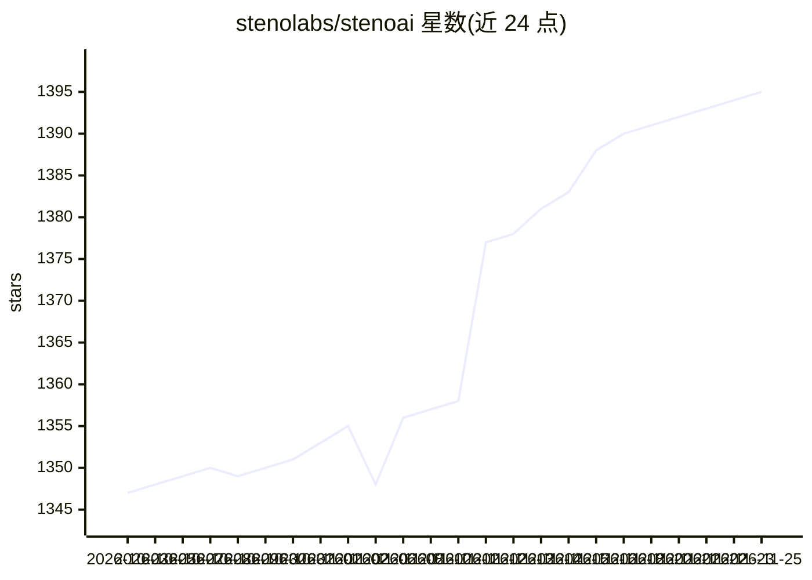

# stenolabs/stenoai

⭐ 1,395 · Python · MIT · 推送 2026-11-24 · [GitHub](https://github.com/stenolabs/stenoai) · [官网](https://stenoai.co/) · 组织维护

**政府/国防场景的本地 AI 会议记事本，录音转写摘要**

面向机密会话的隐私优先 AI 记事本，默认在设备上用本地模型完成录音、实时转写、说话人分离与摘要问答，外部云提供商可选启用。功能涵盖自动检测会议启停、系统音频捕获、25 种语言实时转写（Apple Silicon 经 MLX）、MCP 服务器向 Claude/Cursor 等只读开放笔记、Linear/Notion 等待批准的后续动作、Markdown 导出与 Obsidian 同步。提供 macOS 安装包，Windows 处于 alpha，Linux 受支持。

## 筛选速览

| 维度 | 判定 | 备注 |
|---|---|---|
| AI 角色 | `ai-native` | 本体是模型或模型工具 |
| 许可风险 | `permissive` | MIT |
| 部署形态 | `desktop` | 安装包/桌面程序 |
| 模型依赖 | local-ok | 支持本地模型 |
| 硬件要求 | — | 无带数字的原话,不猜 |
| 安装摩擦 | `medium` | 含编译或系统依赖之一 |
| 成熟度 | — | 结构信号不足 |

## 能力要点

- 本地 AI 默认处理录音/转写/摘要，外部提供商可选
- Parakeet TDT v3 实时转写 25 种语言（Apple Silicon/MLX），Whisper 支持 99 种语言
- 内置 MCP 服务器与 steno 技能，向 Claude、Cursor 等只读开放会议笔记
- 连接 Linear/Notion/Jira 并经用户批准后执行后续动作

## 适用场景

- 政府/国防等机密会议的离线录音与纪要生成
- 会议中实时查看带说话人标注的转写文本
- 让 AI agent 读取本地笔记回答跨会议问题、起草文档

## 场景标签

`语音识别` · 领域:感知与多模态

## 证据(README 行号)

> L15:  StenographAI is a privacy-first AI notepad for confidential conversations. Record, summarise, and query meetings w
> L42: - **Privacy-first**: local AI processes your recordings, transcripts, and summaries on your device. External AI pro
> L64: - **Bring your own cloud model** — Optional OpenRouter, OpenAI, Anthropic, AWS Bedrock (Claude — including applicat

## 星数曲线

2026-10-23 1,347 → 2026-11-25 1,395（+48）

---
*卡片 v1 · prompt 1.4 · 生成 2026-11-24 · 置信度 high · 依据 README sha `2e0624562f78` · [字段定义](../../DATASET.md)*
