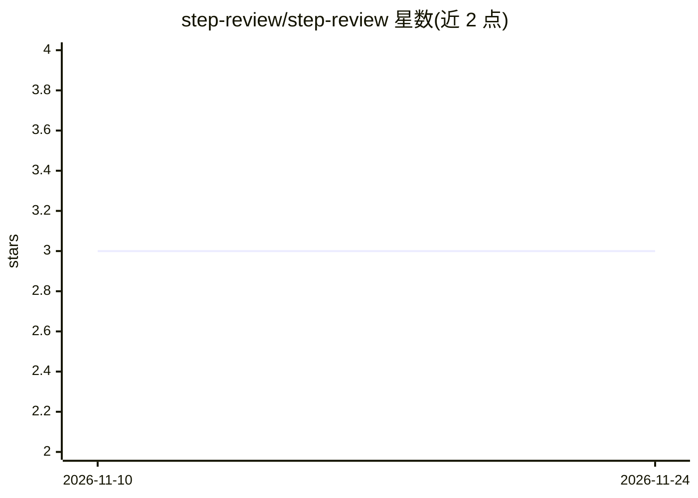

# step-review/step-review

⭐ 3 · TypeScript · MIT · 推送 2026-11-06 · [GitHub](https://github.com/step-review/step-review) · [官网](https://step-review.dev) · 个人维护

**帮开发者借助 AI 分步审阅大型 PR 的工具**

Step Review 是一个 PR 审阅辅助工具：用户让编码 agent 按 SKILL.md 规范生成结构化的 review 文件，该文件把变更拆为有序步骤、附注意事项与严重级别，并锚定到 git diff 的具体行；用户在 step-review.dev 网页中逐步阅读。格式版本化并提供 JSON Schema（@step-review/review-format），配套 CLI（@step-review/cli）用于生成并校验 review 文件。支持通过协作链接多人共同审阅。采用 MIT 许可。

## 筛选速览

| 维度 | 判定 | 备注 |
|---|---|---|
| AI 角色 | `ai-ecosystem` | LLM/agent 周边工具 |
| 许可风险 | `permissive` | MIT |
| 部署形态 | `None` |  |
| 模型依赖 | — | README 未给出锁定关系 |
| 硬件要求 | — | 无带数字的原话,不猜 |
| 安装摩擦 | `low` | 无编译、无系统依赖或容器化 |
| 成熟度 | — | 结构信号不足 |

## 能力要点

- 定义版本化的 review 文件格式并提供 JSON Schema
- SKILL.md 教编码 agent 拆分步骤、标注重点与问题
- notes 锚定到 diff 行，按 high/normal/low 注意力分级
- 支持分享链接的多人协作审阅会话

## 适用场景

- 审阅编码 agent 生成的大量代码改动
- 按步骤逐步理解大型 PR 而非逐行阅读
- 与团队成员共享链接一起讨论 PR

## 场景标签

`代码审查` · 领域:编码与开发

## 证据(README 行号)

> L13: 1. You tell your coding agent to review your PR with the
> L37: Then, Step Review's SKILL.md (published at

## 星数曲线

2026-11-10 3 → 2026-11-24 3（+0）

---
*卡片 v1 · prompt 1.4 · 生成 2026-11-21 · 置信度 mid · 依据 README sha `2091dbce945e` · [字段定义](../../DATASET.md)*
