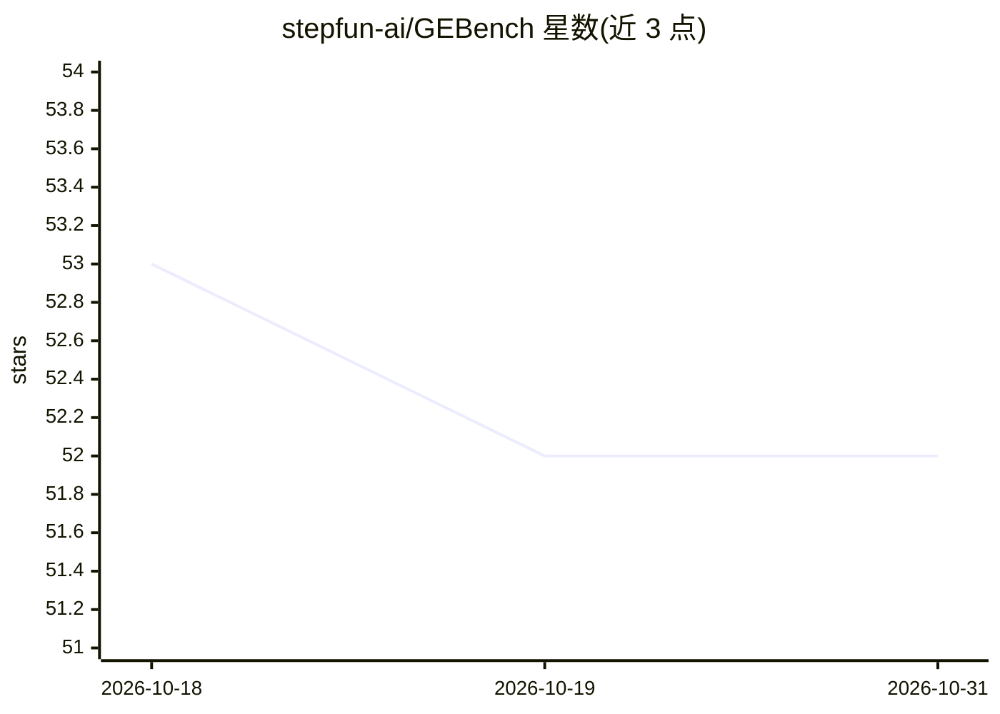

# stepfun-ai/GEBench

⭐ 52 · Python · Apache-2.0 · 推送 2026-02-25 · [GitHub](https://github.com/stepfun-ai/GEBench) · 组织维护 · 中文 README

**图像生成模型作为 GUI 环境的生成能力基准测试**

由 StepFun 维护的基准测试套件，评估文生图模型生成 GUI 环境图像的能力。数据集包含 5 类任务（单步、多步、文本虚构应用、文本真实应用、grounding），支持中英双语提示自动选择，以 goal/logic/consistency/ui/quality 五维指标评分并汇总 GE Score。通过 Python 脚本生成图像（如 Gemini API）并用评估脚本打分（OpenAI API），数据托管于 HuggingFace Datasets。已发布 12 个模型的中英文子集结果。

## 筛选速览

| 维度 | 判定 | 备注 |
|---|---|---|
| AI 角色 | `ai-ecosystem` | LLM/agent 周边工具 |
| 许可风险 | `permissive` | Apache-2.0 |
| 部署形态 | `None` |  |
| 模型依赖 | — | README 未给出锁定关系 |
| 硬件要求 | — | 无带数字的原话,不猜 |
| 安装摩擦 | `low` | 无编译、无系统依赖或容器化 |
| 成熟度 | — | 结构信号不足 |

## 能力要点

- 5 类数据类型：单步/多步/虚构应用/真实应用/grounding
- 中英双语提示自动选择
- goal/logic/consistency/ui/quality 五维评估指标
- 数据集托管于 HuggingFace Datasets

## 适用场景

- 评估图像生成模型生成 GUI 界面图像的能力
- 比较不同文生图模型在 GUI 生成任务上的表现
- 使用中英双语子集进行模型评测实验

## 场景标签

`模型评测` · 领域:评测与运维

## 证据(README 行号)

> L1: # GEBench: Benchmarking Image Generation Models as GUI Environments
> L13: - **5 Data Types**: Type 1 (single-step), Type 2 (multi-step), Type 3 (text-fictionalapp), Type 4 (text-realapp), T
> L52: python scripts/evaluate.py --data-type type1 --output-folder outputs/gemini/01_single_step --dataset-root data --op

## 星数曲线

2026-10-18 53 → 2026-10-31 52（-1）

---
*卡片 v1 · prompt 1.4 · 生成 2026-10-24 · 置信度 high · 依据 README sha `c3edc1977bf5` · [字段定义](../../DATASET.md)*
