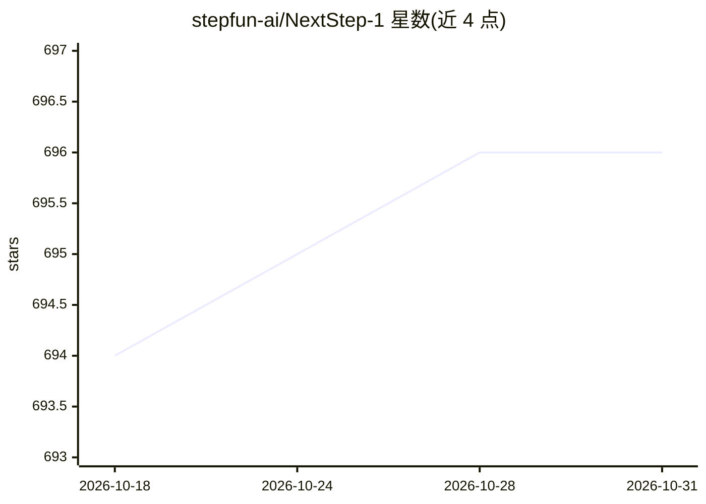

# stepfun-ai/NextStep-1

⭐ 696 · Python · Apache-2.0 · 推送 2026-02-27 · [GitHub](https://github.com/stepfun-ai/NextStep-1) · 组织维护 · 中文 README

**14B 连续 token 自回归图像生成模型的训练与推理代码**

阶跃星辰多模态团队的研究项目：NextStep-1 是 14B 参数的自回归图像生成模型，以连续图像 token 联合建模离散文本 token，文本用标准 LM head、视觉用 157M 参数的 flow matching head。仓库提供训练代码（DeepSpeed 分布式、smartrun 启动器）、推理脚本、数据集处理流程（WebDataset 格式、元数据索引）与 CLI 工具；权重托管在 Hugging Face 与 ModelScope。限制：实际训练使用约 10 亿张不可开源的专有图像，开放数据集仅为演示用途；官方不推荐旧版 NextStep-1 系列模型，建议使用 NextStep-1.1。ICLR 2026 Oral。

## 筛选速览

| 维度 | 判定 | 备注 |
|---|---|---|
| AI 角色 | `ai-native` | 本体是模型或模型工具 |
| 许可风险 | `permissive` | Apache-2.0 |
| 部署形态 | `library` | 以包/库形式分发 |
| 模型依赖 | — | README 未给出锁定关系 |
| 硬件要求 | — | 无带数字的原话,不猜 |
| 安装摩擦 | `medium` | 含编译或系统依赖之一 |
| 成熟度 | — | 结构信号不足 |

## 能力要点

- 连续图像 token + flow matching head 的统一 next-token 预测框架
- 提供 smartrun 分布式训练启动器与 gen_meta/warmup_data 等 CLI 工具
- 多个阶段模型权重托管于 Hugging Face 与 ModelScope
- 支持自定义数据集处理（WebDataset 格式、元数据索引、Streamlit 数据预览）

## 适用场景

- 复现或继续训练自回归图像生成模型
- 基于开放权重做文生图/图像编辑推理
- 按数据处理指南准备自有大规模训练集

## 场景标签

`图像生成` `模型训练` · 领域:内容生成

## 证据(README 行号)

> L7: > NextStep-1 takes a different path: a 14B-parameter autoregressive model that works directly with continuous image 
> L189: smartrun -m configs.nextstep_qwen14b_512px

## 星数曲线

2026-10-18 694 → 2026-10-31 696（+2）

---
*卡片 v1 · prompt 1.4 · 生成 2026-10-21 · 置信度 mid · 依据 README sha `00a3930d0e84` · [字段定义](../../DATASET.md)*
