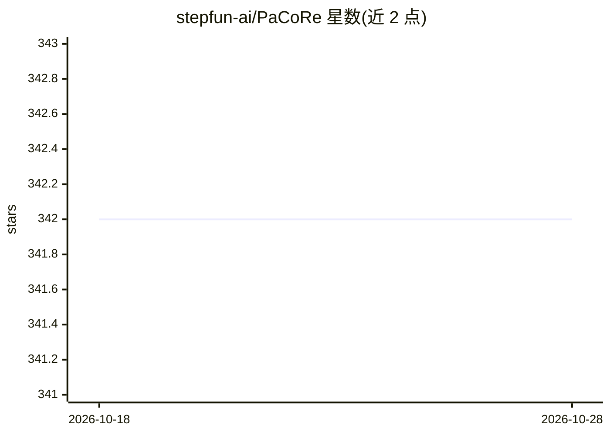

# stepfun-ai/PaCoRe

⭐ 342 · Python · 推送 2026-02-05 · [GitHub](https://github.com/stepfun-ai/PaCoRe) · 组织维护 · 中文 README

**并行协同推理框架：以多轮并行扩展提升测试时计算**

PaCoRe 是一个通过『并行广度』替代『串行深度』来扩展测试时计算的推理框架：每轮发起大规模并行探索轨迹，用消息传递架构将多条轨迹压缩为简洁消息并综合，指导下一轮推理，从而在固定上下文限制下实现百万级 token 的有效推理。项目开源了基于 Qwen3-8B 训练的 PaCoRe-8B 模型检查点、两阶段训练数据（PaCoRe-Train-8k）及完整推理管线，并提供可代理任意上游 LLM 端点（vLLM、OpenRouter 等）的 OpenAI 兼容服务器模式，经 pip 从源码安装运行。限制：结果基于 8B 规模模型的报告实验。

## 筛选速览

| 维度 | 判定 | 备注 |
|---|---|---|
| AI 角色 | `ai-native` | 本体是模型或模型工具 |
| 许可风险 | `none` | — |
| 部署形态 | `library` | 以包/库形式分发 |
| 模型依赖 | local-ok | 支持本地模型 |
| 硬件要求 | — | 无带数字的原话,不猜 |
| 安装摩擦 | `low` | 无编译、无系统依赖或容器化 |
| 成熟度 | — | 结构信号不足 |

## 能力要点

- 多轮并行探索 + 消息传递压缩的推理管线，突破上下文限制扩展测试时计算
- 开源 PaCoRe-8B 模型检查点与 RLVR-8B-0926 初始检查点
- 开源 Stage1-3k / Stage2-5k 两阶段训练数据（数学与代码）
- OpenAI 兼容服务器可代理任意上游 LLM 端点，支持自定义 Exp 子类扩展

## 适用场景

- 用自有 LLM 端点运行多轮并行推理以扩展测试时计算
- 在数学/代码基准上复现或跟进 PaCoRe 训练与评测
- 以 PaCoRe 训练语料监督其他推理模型

## 场景标签

`推理引擎` `微调` · 领域:训练与推理

## 证据(README 行号)

> L7: We introduce **PaCoRe (Parallel Coordinated Reasoning)**, a framework that shifts the driver of inference from seque
> L13: The approach yields strong improvements across diverse domains, and notably pushes reasoning beyond frontier system
> L154: You can run PaCoRe as an OpenAI-compatible server that proxies requests through any upstream LLM provider (vLLM, O

## 星数曲线

2026-10-18 342 → 2026-10-28 342（+0）

---
*卡片 v1 · prompt 1.4 · 生成 2026-10-21 · 置信度 mid · 依据 README sha `04a69bc0a33a` · [字段定义](../../DATASET.md)*
