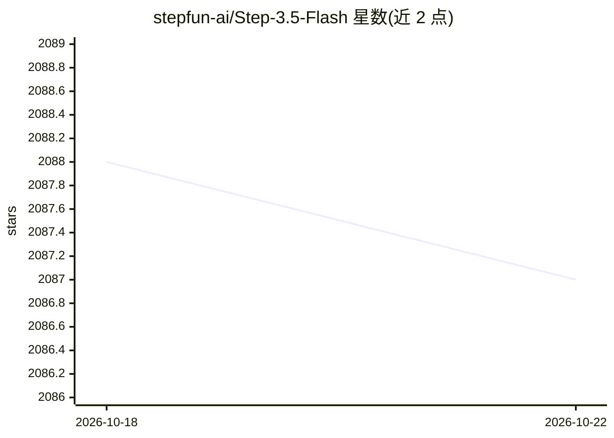

# stepfun-ai/Step-3.5-Flash

⭐ 2,087 · C++ · Apache-2.0 · 推送 2026-04-03 · [GitHub](https://github.com/stepfun-ai/Step-3.5-Flash) · [官网](https://static.stepfun.com/blog/step-3.5-flash/) · 组织维护 · 中文 README

**196B 稀疏 MoE 开源基础模型，面向推理与 Agent 任务**

阶跃星辰开源的基础模型仓库，提供模型权重与部署文档：196B 总参数、每 token 激活约 11B 的稀疏 MoE 架构，256K 上下文窗口（3:1 滑动注意力），MTP-3 多 token 预测，README 报告 SWE-bench Verified 74.4%、生成吞吐 100–300 tok/s。面向需要本地部署或 API 调用的开发者：支持 OpenRouter/StepFun 云 API、vLLM/SGLang/Transformers/llama.cpp 本地推理，llama.cpp GGUF int4 需约 120GB 显存/统一内存。限制：vLLM 完整 MTP-3 支持尚未合入，需用补丁镜像。

## 筛选速览

| 维度 | 判定 | 备注 |
|---|---|---|
| AI 角色 | `ai-native` | 本体是模型或模型工具 |
| 许可风险 | `permissive` | Apache-2.0 |
| 部署形态 | `self-host` | docker 或自建部署 |
| 模型依赖 | local-ok | 支持本地模型 |
| 硬件要求 | `gpu-24g` | |
| 安装摩擦 | `low` | 无编译、无系统依赖或容器化 |
| 成熟度 | `idea` | |

## 能力要点

- 稀疏 MoE：196B 总参数，每 token 激活约 11B，288 路由专家取 Top-8
- 256K 上下文窗口，3:1 滑动窗口注意力混合架构
- MTP-3 多 token 预测，README 报告典型吞吐 100–300 tok/s
- 支持 vLLM/SGLang/Transformers/llama.cpp 四种本地推理后端

## 适用场景

- 通过 OpenRouter 或 StepFun API 调用做推理与 Agent 任务
- 在 Mac Studio/DGX Spark 等大内存硬件上用 llama.cpp GGUF 本地部署
- 用 vLLM/SGLang 自建高吞吐推理服务
- 接入 OpenClaw 等 Agent 平台作为执行模型

## 场景标签

 · 领域:大模型/基础模型

## 证据(README 行号)

> L19: **Step 3.5 Flash** (visit website) is our most capable open-source foundation model, engineered to deliver frontier
> L27: - **A Robust Engine for Coding & Agents**: Step 3.5 Flash is purpose-built for agentic tasks, integrating a scalabl
> L149: Step 3.5 Flash is optimized for local inference and supports industry-standard backends including vLLM, SGLang, Hu

## 星数曲线

2026-10-18 2,088 → 2026-10-22 2,087（-1）

---
*卡片 v1 · prompt 1.4 · 生成 2026-10-21 · 置信度 mid · 依据 README sha `f04f8d907bb2` · [字段定义](../../DATASET.md)*
