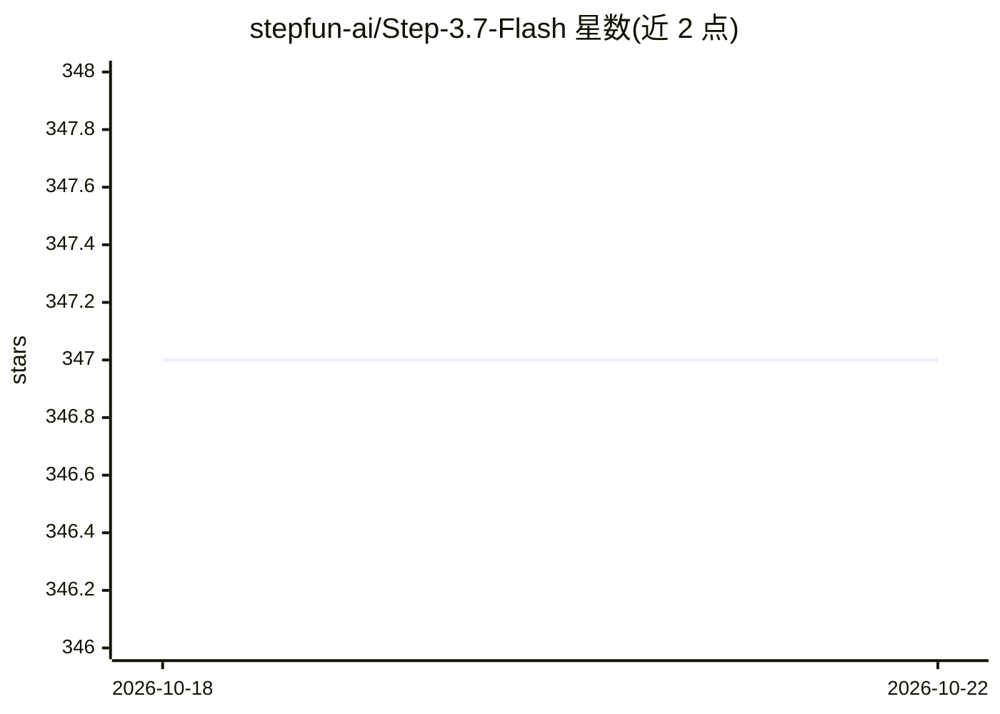

# stepfun-ai/Step-3.7-Flash

⭐ 347 · Apache-2.0 · 推送 2026-06-01 · [GitHub](https://github.com/stepfun-ai/Step-3.7-Flash) · [官网](https://static.stepfun.com/blog/step-3.7-flash/) · 组织维护 · 中文 README

**面向开发者 Agent 工作流的 198B MoE 视觉语言模型**

Step 3.7 Flash 是阶跃星辰开源的 198B 参数稀疏 MoE 视觉语言模型，含 196B 语言主干与 1.8B 视觉编码器，每 token 激活约 11B 参数，支持 256k 上下文与三档可调推理强度。面向需要扩展感知、搜索与推理结合的 Agent 工作流的开发者，可处理多步工具编排、代码工程与图像理解任务。提供 BF16/FP8/NVFP4/GGUF 四种权重，可经 vLLM、SGLang、Transformers、llama.cpp 本地部署，也可经 OpenRouter、NVIDIA NIM 等平台调用；GGUF 本地运行最低需 120GB 统一内存/显存。

## 筛选速览

| 维度 | 判定 | 备注 |
|---|---|---|
| AI 角色 | `ai-native` | 本体是模型或模型工具 |
| 许可风险 | `permissive` | Apache-2.0 |
| 部署形态 | `self-host` | docker 或自建部署 |
| 模型依赖 | local-ok | 支持本地模型 |
| 硬件要求 | `gpu-24g` | |
| 安装摩擦 | `low` | 无编译、无系统依赖或容器化 |
| 成熟度 | — | 结构信号不足 |

## 能力要点

- 198B MoE 架构，每 token 激活约 11B 参数，256k 上下文窗口
- 三档可选推理强度（low/medium/high）
- 提供 BF16/FP8/NVFP4/GGUF 多种量化权重
- NVFP4 检查点含 MTP 草稿层，支持 vLLM 投机解码

## 适用场景

- 运行结合图像理解与工具调用的多步 Agent 工作流
- 在高吞吐流水线中并发运行编码 Agent、定位仓库缺陷并生成补丁
- 本地部署于高内存工作站做推理服务

## 场景标签

 · 领域:大模型/多模态 Agent

## 证据(README 行号)

> L12: Step 3.7 Flash is a 198B-parameter sparse Mixture-of-Experts (MoE) vision-language model that combines a 196B-param
> L14: We built Step 3.7 Flash for developers who need to scale agentic workflows that combine perception, search, and rea

## 星数曲线

2026-10-18 347 → 2026-10-22 347（+0）

---
*卡片 v1 · prompt 1.4 · 生成 2026-10-21 · 置信度 mid · 依据 README sha `2e5bc213ac79` · [字段定义](../../DATASET.md)*
