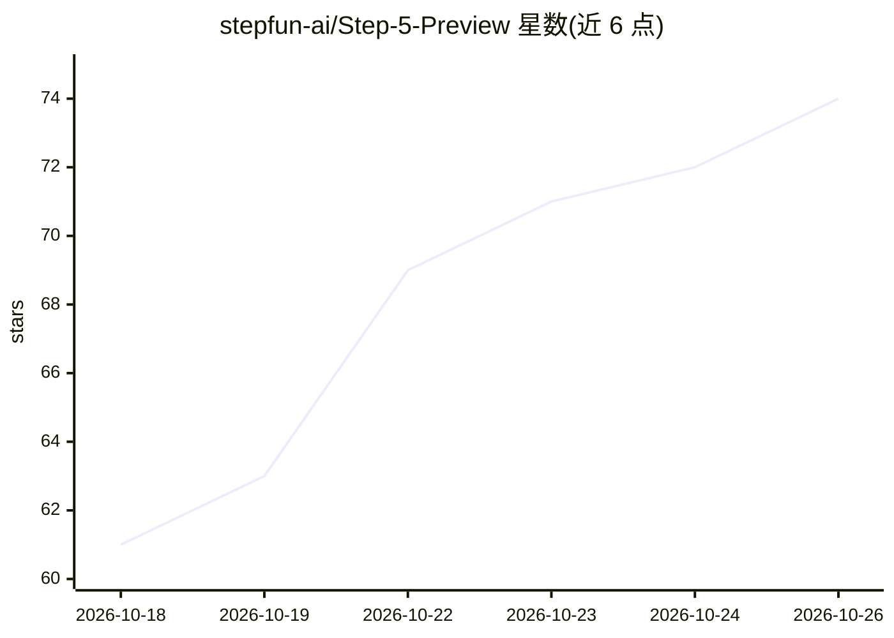

# stepfun-ai/Step-5-Preview

⭐ 74 · NOASSERTION · 推送 2026-10-15 · [GitHub](https://github.com/stepfun-ai/Step-5-Preview) · 组织维护 · 中文 README

**StepFun 面向 agentic 任务的旗舰大模型（600B MoE）**

StepFun 发布的 Step 5 Preview 预览版模型权重仓库：稀疏 MoE 架构，总参数 600B、激活 27B，上下文与输出各最高 1M token，输入文本与图像。面向软件工程（仓库级代码修改、运行验证）、长程 agentic 执行（反复工具调用）与专业知识工作（长文档/图表/视频分析、金融任务）。部署需 vLLM 或 SGLang 通过 OpenAI 兼容 API 服务，或用自带 Transformers 实现离线生成；最低配置为 4 张 B300 GPU（FP8）。BF16 多节点流程尚未端到端验证。

## 筛选速览

| 维度 | 判定 | 备注 |
|---|---|---|
| AI 角色 | `ai-native` | 本体是模型或模型工具 |
| 许可风险 | `none` | NOASSERTION |
| 部署形态 | `self-host` | docker 或自建部署 |
| 模型依赖 | local-ok | 支持本地模型 |
| 硬件要求 | — | 无带数字的原话,不猜 |
| 安装摩擦 | `low` | 无编译、无系统依赖或容器化 |
| 成熟度 | `idea` | |

## 能力要点

- 稀疏 MoE：600B 总参数 / 27B 激活，上下文与输出最高各 1M token
- 仓库级软件工程与长程工具调用执行能力
- 支持 vLLM / SGLang 的 OpenAI 兼容 API 部署及 Transformers 离线生成
- 提供 FP8 与 BF16 两种精度检查点（Hugging Face / ModelScope）

## 适用场景

- 在多卡 GPU 集群上自部署 agentic 编码与知识工作模型
- 处理长文档、图表与视频的多模态分析并生成结构化报告
- 金融场景中结合量化推理与文档分析的模型输出

## 场景标签

`编码 Agent` `多模态` · 领域:编码与开发

## 证据(README 行号)

> L15: Step 5 Preview is StepFun's flagship model for agentic work. It delivers frontier-level performance across software
> L17: Step 5 Preview is a sparse Mixture-of-Experts (MoE) model with 600B total parameters and 27B active parameters. It 

## 星数曲线

2026-10-18 61 → 2026-10-26 74（+13）

---
*卡片 v1 · prompt 1.4 · 生成 2026-10-24 · 置信度 high · 依据 README sha `9ae08864587d` · [字段定义](../../DATASET.md)*
