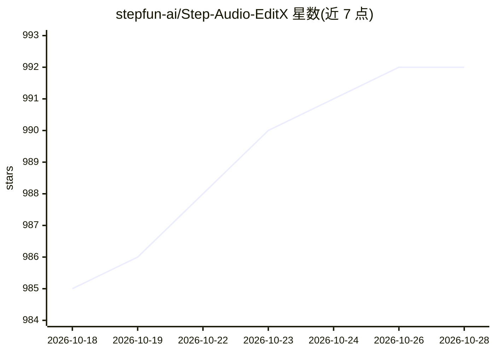

# stepfun-ai/Step-Audio-EditX

⭐ 992 · Python · Apache-2.0 · 推送 2026-04-09 · [GitHub](https://github.com/stepfun-ai/Step-Audio-EditX) · 组织维护 · 中文 README

**3B 音频编辑模型：按标签编辑语音情感、风格与副语言**

阶跃开源的基于 LLM 与强化学习（SFT/DPO/GRPO）的 3B 参数音频编辑模型，提供零样本 TTS/声音克隆（普通话、英语、粤语、川话、日语、韩语）、情感与说话风格编辑（数十种标签）、10 余种副语言标签插入、降噪与语速控制、多音字拼音标注。架构含双码本音频 tokenizer、音频 LLM 与 flow matching 解码器。需 NVIDIA GPU（约 12-16GB 显存），支持 vLLM 推理、AWQ 4bit 量化、Docker 部署与 Gradio Web Demo，另开源 SFT/DPO/GRPO 训练代码。

## 筛选速览

| 维度 | 判定 | 备注 |
|---|---|---|
| AI 角色 | `ai-native` | 本体是模型或模型工具 |
| 许可风险 | `permissive` | Apache-2.0 |
| 部署形态 | `self-host` | docker 或自建部署 |
| 模型依赖 | local-ok | 支持本地模型 |
| 硬件要求 | `gpu-8g` | |
| 安装摩擦 | `low` | 无编译、无系统依赖或容器化 |
| 成熟度 | — | 结构信号不足 |

## 能力要点

- 零样本 TTS 与声音克隆，支持中英粤川及日韩语
- 数十种情感/说话风格标签的迭代式语音编辑
- 副语言标签（笑、叹气、吸气、咳嗽等）与多音字拼音控制
- 提供 SFT/DPO/GRPO 训练代码与 AWQ 4bit 量化路径

## 适用场景

- 把已有录音改成指定情感或说话风格
- 用短参考音频克隆声音做零样本 TTS
- 在合成语音中插入笑声、叹气等副语言并控制多音字读音

## 场景标签

`语音合成` · 领域:内容生成

## 证据(README 行号)

> L27: We are open-sourcing Step-Audio-EditX, a powerful **3B-parameter** LLM-based **Reinforcement Learning** audio model
> L419: - A dual-codebook audio tokenizer, which converts reference or input audio into discrete tokens.
> L420: - An audio LLM that generates dual-codebook token sequences.

## 星数曲线

2026-10-18 985 → 2026-10-28 992（+7）

---
*卡片 v1 · prompt 1.4 · 生成 2026-10-21 · 置信度 high · 依据 README sha `222b5fc87b94` · [字段定义](../../DATASET.md)*
