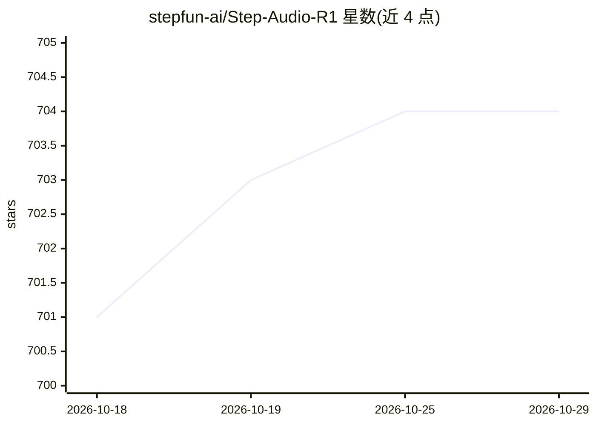

# stepfun-ai/Step-Audio-R1

⭐ 704 · Python · Apache-2.0 · 推送 2026-04-29 · [GitHub](https://github.com/stepfun-ai/Step-Audio-R1) · 组织维护 · 中文 README

**阶跃开源的音频推理语言模型：语音理解与推理生成**

Step-Audio-R1 系列音频推理模型仓库，含 R1/R1.1/R1.5 三代：R1 基于音频编码器（Qwen2 audio encoder）+ LLM 解码器（Qwen2.5 32B），采用模态锚定推理蒸馏（MGRD）训练；R1.1 引入双脑架构实现边思考边输出的低延迟实时语音对话；R1.5 转向 RLHF 对齐。提供推理代码（定制 vLLM 后端，Docker 或源码编译部署）、模型权重（HuggingFace/ModelScope）、Gradio 在线 demo 及三个开源评测基准。运行需 NVIDIA CUDA GPU（4×L40S/H100 等）与 Linux、Python≥3.10；R1.5 推理代码尚未发布。

## 筛选速览

| 维度 | 判定 | 备注 |
|---|---|---|
| AI 角色 | `ai-native` | 本体是模型或模型工具 |
| 许可风险 | `permissive` | Apache-2.0 |
| 部署形态 | `self-host` | docker 或自建部署 |
| 模型依赖 | local-ok | 支持本地模型 |
| 硬件要求 | — | 无带数字的原话,不猜 |
| 安装摩擦 | `low` | 无编译、无系统依赖或容器化 |
| 成熟度 | — | 结构信号不足 |

## 能力要点

- MGRD 训练使推理锚定声学特征而非转写文本
- R1.1 双脑架构实现实时语音对话中的 Chain-of-Thought
- R1.5 采用 RLHF 对齐并开源三个评测基准
- 提供定制 vLLM 的 Docker 镜像与源码编译两种部署方式

## 适用场景

- 在自有 GPU 集群上部署音频理解与语音对话推理服务
- 用 step_caption/step_spqa 等基准评测音频语言模型
- 复现音频推理模型的测试时计算扩展实验

## 场景标签

`语音 Agent` `语音识别` · 领域:对话与助手

## 证据(README 行号)

> L77: Step-Audio-R1 is the **first audio language model to successfully unlock test-time compute scaling**. It decisively
> L92: 3. **LLM Decoder:** We use **Qwen2.5 32B** as the core reasoning component. It directly takes the latent audio feat
> L98: ## Model Usage

## 星数曲线

2026-10-18 701 → 2026-10-29 704（+3）

---
*卡片 v1 · prompt 1.4 · 生成 2026-10-21 · 置信度 mid · 依据 README sha `9b8ba10a8223` · [字段定义](../../DATASET.md)*
