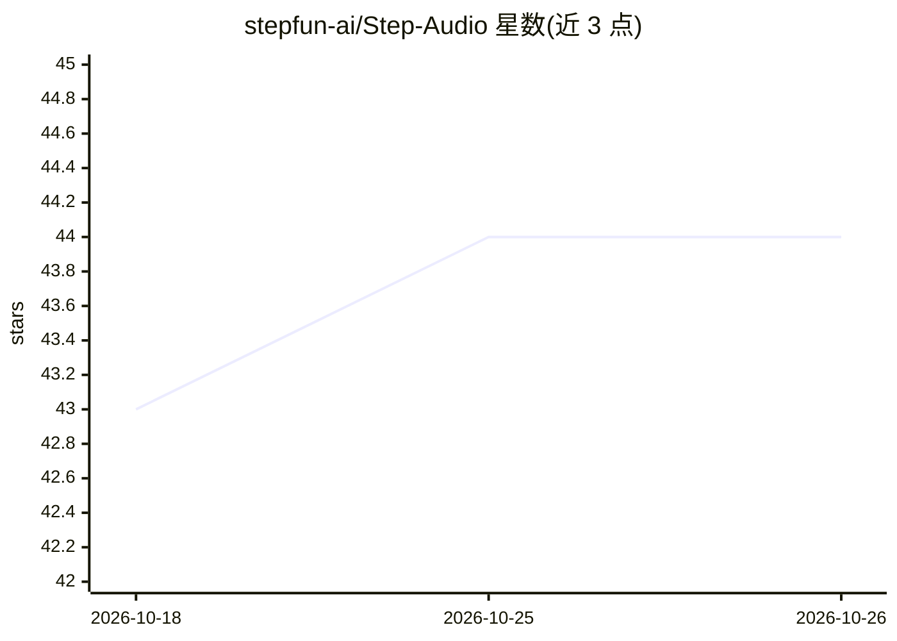

# stepfun-ai/Step-Audio

⭐ 44 · Python · Apache-2.0 · 推送 2026-03-16 · [GitHub](https://github.com/stepfun-ai/Step-Audio) · 组织维护 · 中文 README

**开源语音理解与生成模型：130B 语音对话/克隆/TTS/识别**

Step-Audio 是面向智能语音交互的模型框架，基于 130B 参数 LLM（Step-1）经音频继续预训练与后训练，统一实现语音识别、语义理解、对话、声音克隆与语音合成；采用双码本 tokenizer（语义 1024 码 + 声学 4096 码，2:3 交织）与流匹配加声码器的语音解码器。开源 130B Step-Audio-Chat、Step-Audio-TTS-3B 与 Tokenizer，支持多语言、情感与方言控制。Step-Audio-Chat 最低需 265GB 显存（建议 4×A800/H800），提供离线推理、TTS、Web Demo 与 vLLM 推理路径。注意仓库顶部声明不再维护，后续版本为 Step-Audio2 系列。

## 筛选速览

| 维度 | 判定 | 备注 |
|---|---|---|
| AI 角色 | `ai-native` | 本体是模型或模型工具 |
| 许可风险 | `permissive` | Apache-2.0 |
| 部署形态 | `self-host` | docker 或自建部署 |
| 模型依赖 | local-ok | 支持本地模型 |
| 硬件要求 | — | 无带数字的原话,不猜 |
| 安装摩擦 | `low` | 无编译、无系统依赖或容器化 |
| 成熟度 | — | 结构信号不足 |

## 能力要点

- 130B 参数多模态模型，统一语音理解与生成
- 双码本 tokenizer + 流匹配语音解码器架构
- 开源 Step-Audio-Chat / TTS-3B / Tokenizer 权重
- 支持情感、方言、语速与说唱等声音风格控制

## 适用场景

- 构建多语言语音对话与语音助手应用
- 用 3B TTS 模型做可控语音合成与声音克隆
- 开展语音识别与语音生成的研究评测

## 场景标签

`语音 Agent` `语音合成` `语音识别` `多模态` · 领域:对话与助手

## 证据(README 行号)

> L32: Step-Audio is the first production-ready open-source framework for intelligent speech interaction that harmonizes c
> L34: - **130B-Parameter Multimodal Model**: A single unified model integrating comprehension and generation capabilities

## 星数曲线

2026-10-18 43 → 2026-10-26 44（+1）

---
*卡片 v1 · prompt 1.4 · 生成 2026-10-25 · 置信度 high · 依据 README sha `b1150debbe28` · [字段定义](../../DATASET.md)*
