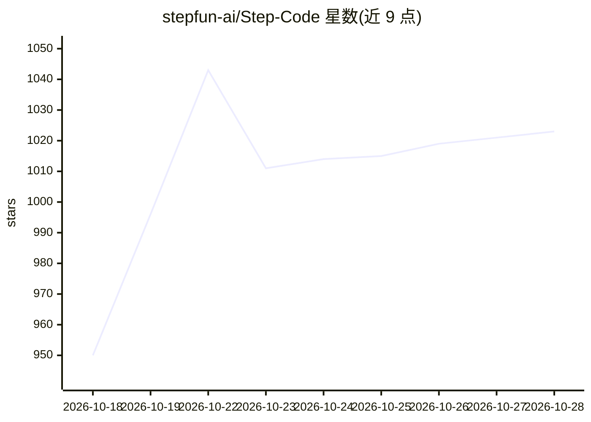

# stepfun-ai/Step-Code

⭐ 1,024 · TypeScript · MIT · 推送 2026-10-28 · [GitHub](https://github.com/stepfun-ai/Step-Code) · 组织维护 · 中文 README

**终端 AI 编程代理：连接 Step 模型完成读码、改码与测试**

StepFun 出品的终端编码代理，绑定内置 Step 提供方（订阅计划 OAuth 或平台 API key 计费），登录后自动发现可用模型。功能覆盖完整任务循环：读取代码、修改文件、运行测试，支持 MCP 服务器、Agent Skills、插件与多代理编排（Ultracode），可将长任务委托给 /goal 自主推进。内置 StepPage 插件可一键把本地目录发布为静态网站。提供 macOS/Linux/WSL 与 Windows 的官方安装脚本，也支持从源码构建。限制：模型提供方仅 Step 一家；Windows PowerShell 支持处于 beta；StepPage 需要 Node.js 20+。

## 筛选速览

| 维度 | 判定 | 备注 |
|---|---|---|
| AI 角色 | `ai-native` | 本体是模型或模型工具 |
| 许可风险 | `permissive` | MIT |
| 部署形态 | `library` | 以包/库形式分发 |
| 模型依赖 | — | README 未给出锁定关系 |
| 硬件要求 | — | 无带数字的原话,不猜 |
| 安装摩擦 | `low` | 无编译、无系统依赖或容器化 |
| 成熟度 | `idea` | |

## 能力要点

- 长任务委托 /goal 与定时 /cron，状态栏显示实时计时
- Ultracode 多代理工作流编排，子代理隔离上下文以节省 token
- 内置 StepPage 插件一键发布静态网站，含版本管理与回滚
- 兼容 MCP、Agent Skills 及多数 Claude Code 插件，自动导入已有 MCP 配置

## 适用场景

- 在终端里让 AI 读懂项目结构并代为修改代码、运行测试
- 把耗时目标交给 /goal 自主推进，定时任务用 /cron
- 脚本/CI 中以 step -p 无头模式批量执行任务
- 开发完成后直接把本地页面发布为可分享的静态站点

## 场景标签

`编码 Agent` `多智能体` · 领域:Agent 开发

## 证据(README 行号)

> L9: Step Code runs in your terminal and handles the full task loop—reading code, making changes, and running tests\. It 

## 星数曲线

2026-10-18 950 → 2026-10-28 1,023（+73）

---
*卡片 v1 · prompt 1.4 · 生成 2026-10-21 · 置信度 mid · 依据 README sha `53067c4f4e75` · [字段定义](../../DATASET.md)*
