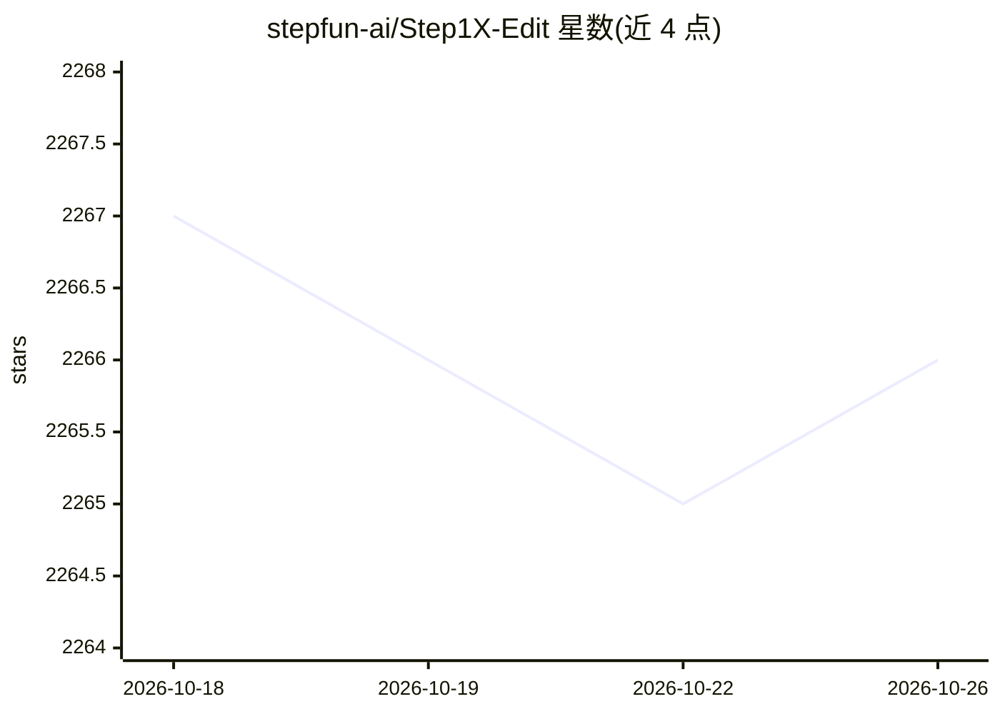

# stepfun-ai/Step1X-Edit

⭐ 2,266 · Python · Apache-2.0 · 推送 2026-04-29 · [GitHub](https://github.com/stepfun-ai/Step1X-Edit) · [官网](https://step1x-edit.github.io) · 组织维护 · 中文 README

**阶跃开源图像编辑模型：指令驱动的图像编辑与生成**

Step1X-Edit 是 StepFun（阶跃星辰）发布的开源图像编辑模型，采用多模态 LLM 处理参考图与编辑指令，提取潜在嵌入并经扩散图像解码器生成目标图。提供 v1.0 至 v1p2 多版本权重（v1p2 具备推理编辑/反思能力），支持文生图、LoRA 微调（单卡 24GB 可训 1024 分辨率）、FP8 量化、模块 offload、TeaCache 与 xDiT 多卡并行推理。基准显存需求较高（1024 分辨率峰值约 49.8GB，FP8+offload 可降至 18GB），测试环境为 cuda-12.1 与 H800 GPU，另发布 GEdit-Bench 评测基准与 ComfyUI 社区插件。

## 筛选速览

| 维度 | 判定 | 备注 |
|---|---|---|
| AI 角色 | `ai-native` | 本体是模型或模型工具 |
| 许可风险 | `permissive` | Apache-2.0 |
| 部署形态 | `desktop` | 安装包/桌面程序 |
| 模型依赖 | — | README 未给出锁定关系 |
| 硬件要求 | `gpu-24g` | |
| 安装摩擦 | `medium` | 含编译或系统依赖之一 |
| 成熟度 | — | 结构信号不足 |

## 能力要点

- 多模态 LLM + 扩散解码器的统一图像编辑架构
- v1p2 提供推理（thinking）与反思（reflection）编辑模式
- 单张 24GB GPU 可完成 1024 分辨率 LoRA 微调
- 支持 FP8 量化、CPU offload、TeaCache 加速与 xDiT 多卡推理

## 适用场景

- 按自然语言指令编辑图像，含复杂推理型编辑
- 文生图任务生成图像
- 针对特定风格（如动漫角色手部修复）做 LoRA 微调
- 在 GEdit-Bench / KRIS-Bench 上评测图像编辑模型

## 场景标签

`图像生成` · 领域:内容生成

## 证据(README 行号)

> L75: We introduce a state-of-the-art image editing model, **Step1X-Edit**, which aims to provide comparable performance 
> L76: More specifically, we adopt the Multimodal LLM to process the reference image and user's editing instruction. A lat

## 星数曲线

2026-10-18 2,267 → 2026-10-26 2,266（-1）

---
*卡片 v1 · prompt 1.4 · 生成 2026-10-21 · 置信度 high · 依据 README sha `2961a5108473` · [字段定义](../../DATASET.md)*
