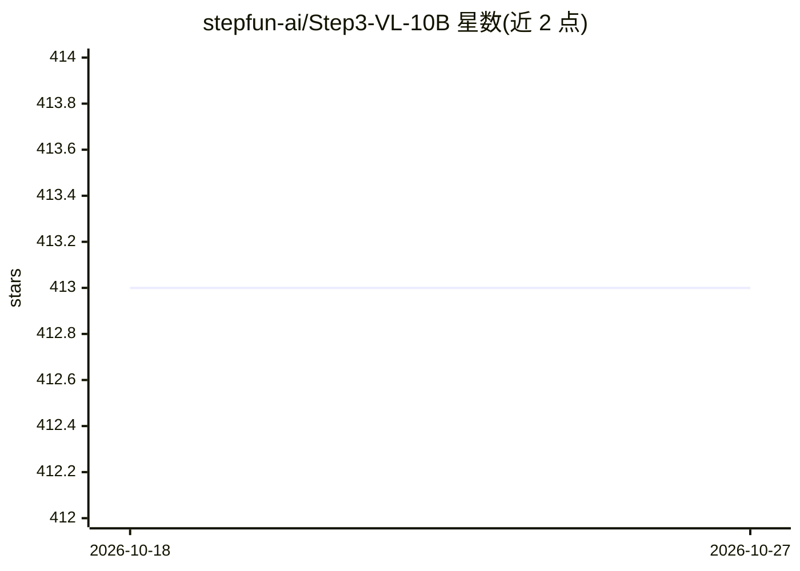

# stepfun-ai/Step3-VL-10B

⭐ 413 · Apache-2.0 · 推送 2026-01-21 · [GitHub](https://github.com/stepfun-ai/Step3-VL-10B) · 组织维护 · 中文 README

**10B 参数开源多模态基础模型，视觉感知与推理**

阶跃星辰开源的 10B 参数多模态基础模型，含 Base 与 Chat 两个版本，架构为 1.8B 参数的 PE-lang 视觉编码器加 Qwen3-8B 解码器。在 1.2T token 多模态语料上单阶段全解冻预训练，后经两阶段 SFT 与 1,400 余轮强化学习（RLVR/RLHF）。提供 SeRe 顺序推理与 PaCoRe 并行协调推理两种模式，支持 GUI grounding、OCR 与数学推理等任务。通过 Hugging Face/ModelScope 下载权重，需 transformers>=4.57.0、torch>=2.1.0，目前仅支持 bf16 推理。Apache 2.0 许可。

## 筛选速览

| 维度 | 判定 | 备注 |
|---|---|---|
| AI 角色 | `ai-native` | 本体是模型或模型工具 |
| 许可风险 | `permissive` | Apache-2.0 |
| 部署形态 | `None` |  |
| 模型依赖 | — | README 未给出锁定关系 |
| 硬件要求 | — | 无带数字的原话,不猜 |
| 安装摩擦 | `low` | 无编译、无系统依赖或容器化 |
| 成熟度 | — | 结构信号不足 |

## 能力要点

- SeRe 顺序推理（64K）与 PaCoRe 并行协调推理（128K、16 路并行采样）两种推理模式
- GUI grounding / OCR / 数学推理等多模态基准评测结果
- 权重提供 Base 与 Chat 两个版本，经 Hugging Face 与 ModelScope 分发

## 适用场景

- 本地部署一个中小规模多模态模型做图文理解与推理
- GUI grounding 与文档 OCR 类任务
- 数学与代码类多模态推理任务（AIME、HumanEval-V）

## 场景标签

`多模态` `OCR` · 领域:感知与多模态

## 证据(README 行号)

> L10: **STEP3-VL-10B** is a lightweight open-source foundation model designed to redefine the trade-off between compact e
> L84: - **Visual Encoder:** PE-lang (Language-Optimized Perception Encoder), 1.8B parameters.
> L85: - **Decoder:** Qwen3-8B.

## 星数曲线

2026-10-18 413 → 2026-10-27 413（+0）

---
*卡片 v1 · prompt 1.4 · 生成 2026-10-21 · 置信度 high · 依据 README sha `551f542b0848` · [字段定义](../../DATASET.md)*
