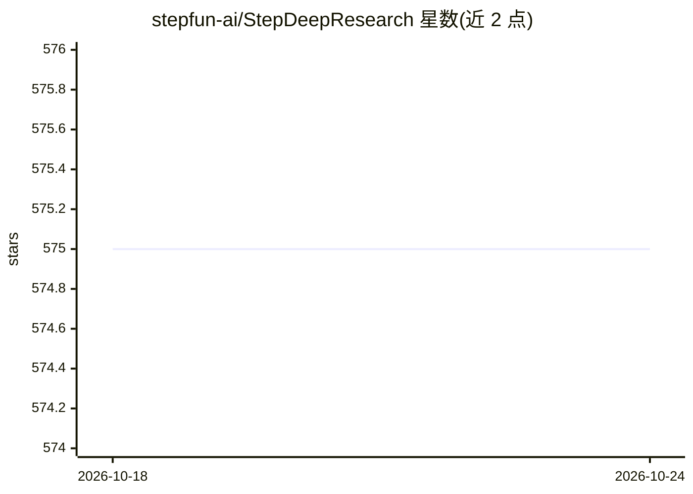

# stepfun-ai/StepDeepResearch

⭐ 575 · Python · Apache-2.0 · 推送 2026-03-24 · [GitHub](https://github.com/stepfun-ai/StepDeepResearch) · 组织维护 · 中文 README

**端到端深度研究 agent 模型：自主探索信息并生成专业调研报告**

StepFun（阶跃星辰）发布的深度研究 agent 模型，基于 ReAct 单 agent 架构，将规划、信息检索、反思交叉验证与专业报告生成内化为模型原子能力，配合 batch_web_surfer、file、todo、shell 等工具完成自主研究闭环。训练路径为 Agentic Mid-Training → SFT → RL。模型经 Mid-Training 到 SFT 与 RL 的渐进训练得到；目前以 StepFun 开放平台 API 形式提供（首月免费），未见本地权重或安装方式。

## 筛选速览

| 维度 | 判定 | 备注 |
|---|---|---|
| AI 角色 | `ai-native` | 本体是模型或模型工具 |
| 许可风险 | `permissive` | Apache-2.0 |
| 部署形态 | `library` | 以包/库形式分发 |
| 模型依赖 | — | README 未给出锁定关系 |
| 硬件要求 | — | 无带数字的原话,不猜 |
| 安装摩擦 | `low` | 无编译、无系统依赖或容器化 |
| 成熟度 | — | 结构信号不足 |

## 能力要点

- ReAct 单 agent 架构，单次推理内闭环反思与动态纠错
- 内置 batch_web_surfer/file/todo/shell 工具集
- Agentic Mid-Training → SFT → RL 渐进训练管线
- 含 Step 3.5 Flash 版本，可通过环境变量 MODEL_NAME 切换

## 适用场景

- 输入开放式研究问题，自动完成检索与交叉验证并产出调研报告
- 通过 StepFun 开放平台 API 调用深度研究能力
- 参考其模型生成报告样例评估研究质量

## 场景标签

`科研工具` `AI 写作` · 领域:内容生成

## 证据(README 行号)

> L24:  **Step-DeepResearch** is a cost-effective, end-to-end deep research agent model designed for autonomous informatio
> L40:  Step-DeepResearch adopts a single-agent architecture based on the ReAct paradigm, enabling autonomous deep researc

## 星数曲线

2026-10-18 575 → 2026-10-24 575（+0）

---
*卡片 v1 · prompt 1.4 · 生成 2026-10-21 · 置信度 mid · 依据 README sha `d04a679e8796` · [字段定义](../../DATASET.md)*
