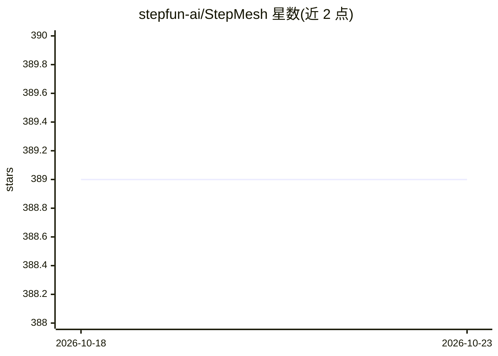

# stepfun-ai/StepMesh

⭐ 389 · C++ · Apache-2.0 · 推送 2026-01-28 · [GitHub](https://github.com/stepfun-ai/StepMesh) · 组织维护 · 中文 README

**Attention-FFN 分离架构的高性能低延迟通信库**

StepFun 开发的分布式通信库，服务于 Attention-FFN 解耦（分离式推理/训练）架构下节点间的张量传输。提供统一的 ZeroCopy ZBatchPushPull 接口，基于 RDMA 实现高速低延迟通信，含 AFTensorWorker/AFTensorServer API 与 CPU/GPU 后端，xPU 后端为预留占位；代码基于 BytePS 开发。采用 worker/server/scheduler 三进程角色模型，操作异步。需自行从源码编译，环境要求 Ubuntu、RDMA 网卡、GPU 与 torch>=2.0，也支持无 CUDA 编译。

## 筛选速览

| 维度 | 判定 | 备注 |
|---|---|---|
| AI 角色 | `ai-ecosystem` | LLM/agent 周边工具 |
| 许可风险 | `permissive` | Apache-2.0 |
| 部署形态 | `None` |  |
| 模型依赖 | — | README 未给出锁定关系 |
| 硬件要求 | — | 无带数字的原话,不猜 |
| 安装摩擦 | `medium` | 含编译或系统依赖之一 |
| 成熟度 | — | 结构信号不足 |

## 能力要点

- 统一的 ZeroCopy ZBatchPushPull 张量传输接口
- 基于 RDMA 的高带宽低延迟通信，支持多种加速器后端（CPU/GPU，xPU 预留）
- AFTensorWorker / AFTensorServer API 管理注意力节点与 FFN 节点间通信
- worker/server/scheduler 三角色进程模型，全异步操作

## 适用场景

- Attention-FFN 分离式部署中做跨节点张量推送与拉取
- 在配备 RDMA 网卡与 GPU 的集群上搭建分离式推理/训练通信层
- 通过 CPU 后端将通信任务从 GPU 卸载到 CPU

## 场景标签

 · 领域:分布式系统/LLM 基础设施

## 证据(README 行号)

> L1: # StepMesh: A High-Performance, Low-Latency Communication Library for Attention-FFN Disaggregation
> L3: StepMesh is a communication library designed to provide high-performance and low-latency
> L17: - **Low Latency**: StepMesh is engineered to provide the ultra-low latency communication essential for Attention-FF

## 星数曲线

2026-10-18 389 → 2026-10-23 389（+0）

---
*卡片 v1 · prompt 1.4 · 生成 2026-10-21 · 置信度 high · 依据 README sha `ab39b98ba272` · [字段定义](../../DATASET.md)*
