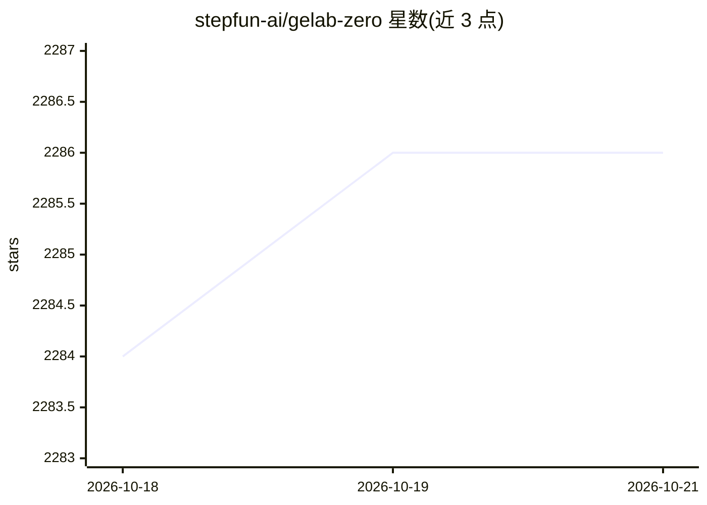

# stepfun-ai/gelab-zero

⭐ 2,286 · Python · MIT · 推送 2026-05-11 · [GitHub](https://github.com/stepfun-ai/gelab-zero) · [官网](https://opengelab.github.io/) · 组织维护 · 中文 README

**开源 GUI Agent：4B 手机操作模型加本地推理工程设施**

StepFun GELab 团队开源的 GUI Agent 方案，包含可在消费级硬件本地运行的 4B 模型与即插即用的推理工程设施：统一部署管线自动处理环境依赖与多设备 ADB 管理，支持任务分发到多台手机并记录交互轨迹，覆盖 ReAct、多智能体协作与定时任务三种模式。提供 MCP Server 支持多设备管理与任务分发。本地推理后端经验证支持 ollama 与 vllm，可完全本地部署、无云端依赖。另发布 AndroidDaily 基准（3146 静态动作、235 端到端任务）及 Hugging Face/ModelScope 上的模型与数据集。

## 筛选速览

| 维度 | 判定 | 备注 |
|---|---|---|
| AI 角色 | `ai-native` | 本体是模型或模型工具 |
| 许可风险 | `permissive` | MIT |
| 部署形态 | `library` | 以包/库形式分发 |
| 模型依赖 | local-ok | 支持本地模型 |
| 硬件要求 | — | 无带数字的原话,不猜 |
| 安装摩擦 | `low` | 无编译、无系统依赖或容器化 |
| 成熟度 | `idea` | |

## 能力要点

- 4B GUI Agent 模型可在消费级硬件本地运行
- 一键部署管线自动处理环境依赖与多设备 ADB 管理
- 任务分发到多手机并记录交互轨迹
- MCP Server 支持多设备管理与任务分发，三种 Agent 模式

## 适用场景

- 让 Agent 在安卓手机上自动完成购物、点外卖、打车等日常任务
- Agent 开发者快速测试新的交互策略并复现轨迹
- 企业复用该设施把 MCP 能力接入产品业务

## 场景标签

`GUI 自动化` · 领域:效率与自动化

## 证据(README 行号)

> L44: To address this challenge, we are open-sourcing GELab-Zero to accelerate the innovation and application deployment 

## 星数曲线

2026-10-18 2,284 → 2026-10-21 2,286（+2）

---
*卡片 v1 · prompt 1.4 · 生成 2026-10-21 · 置信度 high · 依据 README sha `cc6548ddad93` · [字段定义](../../DATASET.md)*
