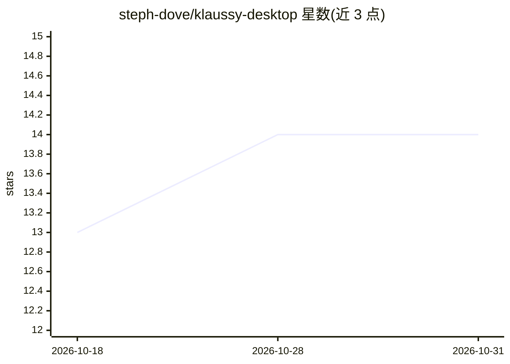

# steph-dove/klaussy-desktop

⭐ 14 · JavaScript · NOASSERTION · 推送 2026-10-29 · [GitHub](https://github.com/steph-dove/klaussy-desktop) · [官网](https://klaussy.com) · 组织维护

**多智能体编码 IDE：并行运行编码 agent 并在提交前审查**

基于 Electron 的桌面 IDE，将 Claude Code、Codex、Gemini、Copilot、Antigravity、Cursor 等多种编码 agent 并行运行于彼此隔离的 Git worktree 中，支持多仓库会话、跨 agent 会话交接、向全部 agent 广播同一提示词。内置提交时审查门（pre-commit/pre-push 钩子触发 agent 审计，检查凭据泄露、静默失败等）。支持粘贴 PR/MR URL 免本地检出做 AI 审查，通过 Slack/Discord 远程批准 agent 操作。许可证为 Sustainable Use License，个人与非商业用途免费，商业用途需另购商业许可。

## 筛选速览

| 维度 | 判定 | 备注 |
|---|---|---|
| AI 角色 | `ai-ecosystem` | LLM/agent 周边工具 |
| 许可风险 | `none` | NOASSERTION |
| 部署形态 | `library` | 以包/库形式分发 |
| 模型依赖 | local-ok | 支持本地模型 |
| 硬件要求 | — | 无带数字的原话,不猜 |
| 安装摩擦 | `low` | 无编译、无系统依赖或容器化 |
| 成熟度 | — | 结构信号不足 |

## 能力要点

- 一任务一 worktree 一 agent 的并行隔离运行，支持 9 种 agent CLI/扩展
- 提交时审查门：agent 审计凭据泄露、调试残留、静默失败并自动整理代码
- 跨 agent 会话交接：生成结构化交接简报后可切换到另一 agent 继续
- 从 Slack/Discord 审批 agent 权限请求，无需公网 URL 或开放端口

## 适用场景

- 在多个隔离 worktree 中并行运行多个编码 agent 处理不同任务
- 提交前自动审查 agent 生成代码中的凭据泄露与正确性问题
- 不检出代码的情况下对 GitHub/GitLab/Bitbucket 的 PR/MR 做 AI 审查
- 跨多个微服务仓库协调同一任务分支上的 agent 协作

## 场景标签

`多智能体` `编码 Agent` `代码审查` · 领域:Agent 开发

## 证据(README 行号)

> L22:  One task = one git worktree + one independent agent. Run Claude Code, Codex, Gemini, Antigravity, Copilot, Cursor,
> L27: * **🛡️ Commit-Time Review Gate**
> L28:  A built-in pre-commit and pre-push hook runs an agent-powered audit looking for silent failures, leaked credential

## 星数曲线

2026-10-18 13 → 2026-10-31 14（+1）

---
*卡片 v1 · prompt 1.4 · 生成 2026-10-31 · 置信度 high · 依据 README sha `574d8dccc7aa` · [字段定义](../../DATASET.md)*
