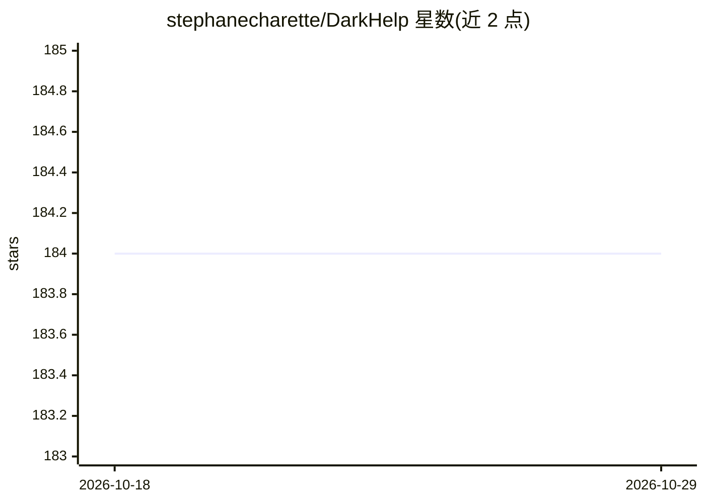

# stephanecharette/DarkHelp

⭐ 184 · C++ · MIT · 推送 2026-02-25 · [GitHub](https://github.com/stephanecharette/DarkHelp) · [官网](https://www.ccoderun.ca/darkhelp/api/Summary.html) · 个人维护

**封装 Darknet 的 C++ 库：加载 YOLO 网络并做图像推理**

C++ 包装库，封装 Darknet 的 C 功能（libdarknet.so）：加载 .cfg/.names/.weights 格式神经网络，对图像文件或 OpenCV cv::Mat / 视频帧运行推理并返回结果向量，可选对图像标注检测结果。附带 CLI 工具用于测试与脚本，以及 DarkHelp Server（只加载一次网络、持续处理图像/视频帧并保存 txt/json 结果、标注图或裁剪目标）。面向在 C++ 应用中集成 Darknet/YOLO 推理的开发者，需先构建安装 Darknet 与 OpenCV 等依赖，Linux/Windows 均从源码构建。

## 筛选速览

| 维度 | 判定 | 备注 |
|---|---|---|
| AI 角色 | `ai-native` | 本体是模型或模型工具 |
| 许可风险 | `permissive` | MIT |
| 部署形态 | `desktop` | 安装包/桌面程序 |
| 模型依赖 | — | README 未给出锁定关系 |
| 硬件要求 | — | 无带数字的原话,不猜 |
| 安装摩擦 | `high` | 编译与系统依赖俱全 |
| 成熟度 | — | 结构信号不足 |

## 能力要点

- 加载 Darknet 格式网络并对图像/视频帧运行推理，返回结果向量
- 可选 annotate() 标注图像，支持图像 tiling
- CLI 工具与常驻后台的 DarkHelp Server（txt/json/裁剪输出）
- MIT 许可，Linux 与 Windows 构建说明

## 适用场景

- 在 C++ 应用中集成 Darknet/YOLO 目标检测
- 通过命令行批量对图像或视频帧跑检测
- 常驻服务持续对图像流做检测并保存结果

## 场景标签

`目标检测` · 领域:感知与多模态

## 证据(README 行号)

> L3: The DarkHelp C++ API is a wrapper to make it easier to use the Darknet neural network framework within a C++ applica
> L5: - load a Darknet-style neural network (.cfg, .names, .weights)
> L6: - run inference on images -- either filenames or OpenCV `cv::Mat` images and video frames -- and return a vector of 

## 星数曲线

2026-10-18 184 → 2026-10-29 184（+0）

---
*卡片 v1 · prompt 1.4 · 生成 2026-10-22 · 置信度 high · 依据 README sha `9c81b3f2977e` · [字段定义](../../DATASET.md)*
