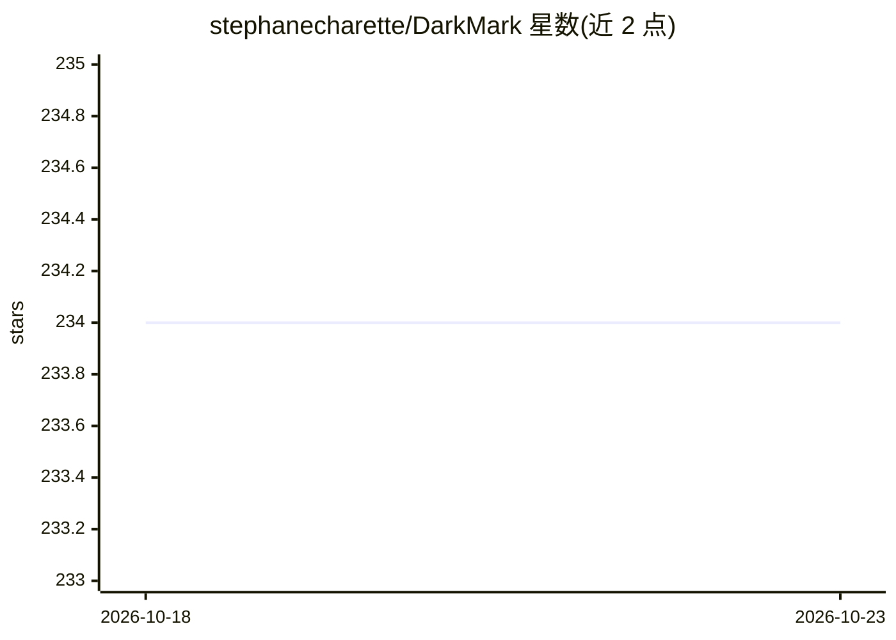

# stephanecharette/DarkMark

⭐ 234 · C++ · NOASSERTION · 推送 2026-09-30 · [GitHub](https://github.com/stephanecharette/DarkMark) · [官网](https://www.ccoderun.ca/darkmark/Summary.html) · 个人维护

**为 Darknet/YOLO 标注图像的 C++ 桌面工具**

C++ GUI 图像标注工具，面向使用 Darknet 神经网络框架的用户：可为项目加载 Darknet 风格网络辅助标注更多图像，提供多种审查能力以快速检查标注并高亮常见错误；标注完成后可生成 Darknet 与 YOLO 训练所需的 .cfg、.data、训练/验证 .txt 等配置文件及启动训练的 shell 脚本。构建依赖 Darknet 与 DarkHelp，需在 Ubuntu 上从源码编译安装。

## 筛选速览

| 维度 | 判定 | 备注 |
|---|---|---|
| AI 角色 | `ai-ecosystem` | LLM/agent 周边工具 |
| 许可风险 | `none` | NOASSERTION |
| 部署形态 | `None` |  |
| 模型依赖 | — | README 未给出锁定关系 |
| 硬件要求 | — | 无带数字的原话,不猜 |
| 安装摩擦 | `medium` | 含编译或系统依赖之一 |
| 成熟度 | — | 结构信号不足 |

## 能力要点

- 针对 Darknet/YOLO 定制的图像标注功能
- 可加载 Darknet 网络辅助标注（预标注）
- 标注审查功能高亮常见标注错误
- 生成 .cfg/.data/.txt 训练配置文件与训练 shell 脚本

## 适用场景

- 为 YOLO 目标检测训练准备标注数据集
- 审查已有标注并修正常见错误
- 一键生成 Darknet 训练所需配置文件与脚本

## 场景标签

`目标检测` · 领域:感知与多模态

## 证据(README 行号)

> L5: DarkMark is a C++ GUI tool used to annotate images for use in neural networks. It was written specifically to be use
> L9: When you first launch DarkMark, you can specify a Darknet-style neural network to load with the selected project. Da

## 星数曲线

2026-10-18 234 → 2026-10-23 234（+0）

---
*卡片 v1 · prompt 1.4 · 生成 2026-10-22 · 置信度 high · 依据 README sha `4ea0ddbc3567` · [字段定义](../../DATASET.md)*
